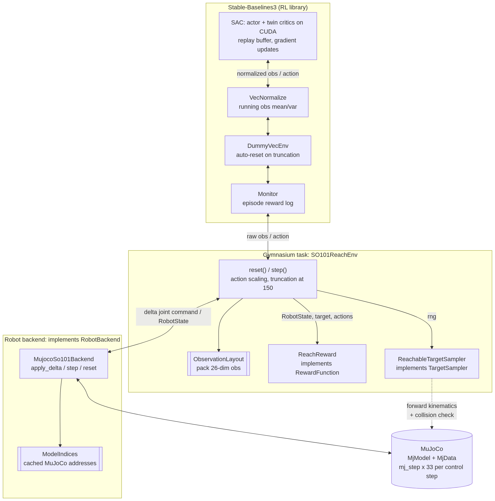
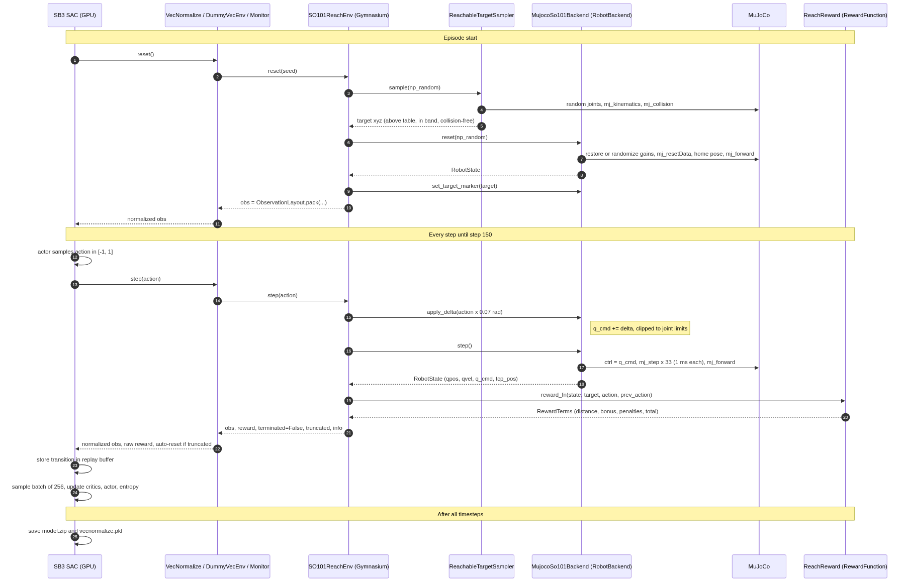
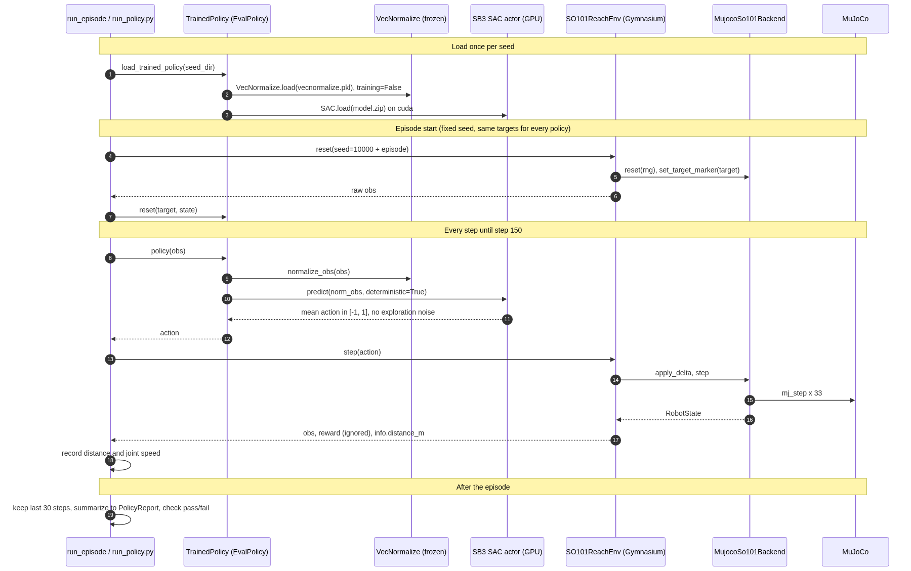

# rbe501_group_project

A Gripping Story: Sim2Real with the SO-101 robot

The working MuJoCo scene is `models/so101/so101.xml`. It contains the robot,
table, floor, lighting, and a 50 mm cube. Simulation uses a 1 ms timestep,
`implicitfast`, and critically damped position actuators. Cube collisions are
enabled; the three problematic base meshes remain non-colliding.

## End-effector and IK

`gripper_site` is the TCP reference. Its position
`-0.0079 -0.000218121 -0.0981274` and quaternion `0 0 1 0` are unchanged.
The position matches `gripper_frame_joint` in the supplied SO-101 URDF.
This frame belongs to the stationary gripper body; opening the moving finger
does not move the TCP relative to that body.

Position-only damped least-squares IK uses five arm joints, their joint limits,
and one site Jacobian. Gripper opening is commanded separately and held at 40
degrees during the IK test. The test target remains 6 cm above the cube's initial
center; orientation, grasp planning, and RL are future work.

Gravity compensation is disabled in the MJCF (`gravcomp="0"`), and the
reach backend caps joint torque at the servo stall torque, so the arm sags
under its own weight the way the real robot does.

## Reach environment and RL baseline

The Gymnasium reach task lives in `src/rbe_501_so101/`. Training, evaluation,
policies, and the CLI are split so they can be imported in tests:

| Module | Role |
|---|---|
| `rbe_501_so101.rl.training` | `Monitor` + `VecNormalize` env factory, SAC/PPO, one-seed train |
| `rbe_501_so101.rl.evaluation` | episode rollout, reports, pass/fail vs IK-hold |
| `rbe_501_so101.rl.policies` | trained, random, and IK-hold policies |
| `rbe_501_so101.rl.cli` | argparse entry point |

```bash
python scripts/train_reach.py --algo sac --timesteps 300000 --seeds 0 1 2 --model-dir checkpoints/reach_scaled
python scripts/train_reach.py --eval --model-dir checkpoints/reach_scaled --num-episodes 20
python scripts/run_policy.py --model-dir checkpoints/reach_scaled --seed 0   # watch it in the viewer
python scripts/benchmark_env.py
```

Training uses the GPU automatically and fails fast if CUDA is missing; pass
`--cpu` to train on the CPU on purpose. Experiment records (config, eval
report, plots) live in `experiments/`.

In this devcontainer the interpreter is
`/home/vscode/miniforge3/envs/lerobot/bin/python`. On a host with `uv`,
`uv lock` / `uv sync` is the other supported path; keep `uv.lock` in sync
with `pyproject.toml`.

### Why SAC

Soft Actor-Critic is the default algorithm (`--algo sac`); PPO stays
available for comparison.

- **Continuous actions.** The policy outputs five joint-command deltas in
  [−1, 1]. SAC is built for continuous action spaces, so no discretization
  is needed.
- **Sample efficiency.** SAC is off-policy: it reuses every transition from a
  replay buffer many times. On-policy PPO discards data after each update and
  typically needs several times more environment steps.
- **Built-in exploration.** SAC maximizes reward plus policy entropy, with the
  entropy weight tuned automatically. There is no exploration-noise schedule
  to hand-tune, unlike TD3 or DDPG.
- **Stable value estimates.** Twin Q-networks reduce value overestimation, and
  the stochastic policy tends to tolerate the randomized motor gains and
  payloads used in evaluation.
- **Correct time-limit handling.** Episodes are truncated, not terminated, at
  150 steps, so SAC keeps bootstrapping value from the final state. This
  suits a task where the arm must keep holding the target.
- **Common baseline.** SAC is a standard choice for robot-arm reaching and
  manipulation, which makes results easy to compare with published work.

Known trade-offs for this task:

- **Entropy works against holding still.** Training favors spread-out actions,
  which may contribute to the policy hovering near the target instead of
  settling. Lowering or fixing `target_entropy` is a cheap test.
- **Reward-scale sensitivity.** The entropy bonus competes directly with
  reward magnitude, so rescaling the reward changes behavior.
- **Seed variance.** Results differ noticeably between seeds at 300k steps, so
  every experiment trains and reports three seeds.

## How the code flows

Three layers hand control to each other on every step:

1. **Stable-Baselines3 (the RL library)** owns the training loop. It decides
   when to reset, picks actions, stores transitions, and updates the networks.
2. **Gymnasium (`SO101ReachEnv`)** owns the task. It turns a normalized action
   into a joint command, asks the backend to simulate, scores the result with
   the reward function, and packs the observation.
3. **The MuJoCo backend (`MujocoSo101Backend`)** owns the robot. It integrates
   joint commands, runs the physics substeps, and reports the robot's state.

SB3 never touches MuJoCo, and `SO101ReachEnv` never touches MuJoCo directly
either: it only talks to the backend through the `RobotBackend` protocol.
That boundary is what lets a future hardware backend replace the simulator.

### Layers and boundaries



<sub>Source: [`docs/diagrams/layers.mmd`](docs/diagrams/layers.mmd). Re-render with `python scripts/render_diagrams.py`.</sub>

### Training: who calls whom

`train_seed` builds the stack once per seed: `gym.make("SO101Reach-v0")`
constructs `SO101ReachEnv`, which builds the MuJoCo backend, the target
sampler (sharing the backend's model), and the reward. It is wrapped in
`Monitor`, `DummyVecEnv`, and `VecNormalize`, and handed to SAC. Then
`model.learn()` takes over and drives everything below:



<sub>Source: [`docs/diagrams/training_flow.mmd`](docs/diagrams/training_flow.mmd). Re-render with `python scripts/render_diagrams.py`.</sub>

The reward that drives learning is computed in step 19:

```text
total = -100 * d  +  exp(-(d / 5 mm)^2)  -  0.01 * |a|^2  -  0.01 * |a - a_prev|^2
         approach      sag-correction       action size     action jitter
         (cm scale)    bonus (< ~1 cm)
```

Truncation at 150 steps is flagged as a time limit, not a real ending, so
SAC keeps bootstrapping value from the final state.

### Inference / evaluation: who calls whom

At inference there is no SB3 training loop. Our own code
(`run_episode` in `rl/evaluation.py`, or `scripts/run_policy.py`) drives the
loop, and SB3 is only asked for an action. `VecNormalize` is loaded with
`training=False` so its statistics are frozen at their training values.



<sub>Source: [`docs/diagrams/inference_flow.mmd`](docs/diagrams/inference_flow.mmd). Re-render with `python scripts/render_diagrams.py`.</sub>

The environment-to-backend path is identical in both modes. Only the caller
changes: SB3's `learn()` during training, our loop at inference.

### Key protocols (the boundaries)

These live in `envs/protocols.py` and `rl/policies.py`. Each is a
`typing.Protocol`, so anything with matching methods plugs in without
inheriting from a base class.

| Protocol | Methods | Implemented by | Why it exists |
|---|---|---|---|
| `RobotBackend` | `reset(rng)`, `apply_delta(delta)`, `step()`, `joint_limits()`, `close()` | `MujocoSo101Backend` | The env drives the robot only through this, so a hardware backend can replace MuJoCo |
| `TargetMarker` | `set_target_marker(xyz)` | `MujocoSo101Backend` | Optional: show the target (red sphere) |
| `Renderable` | `render()`, `is_open()` | `MujocoSo101Backend` | Optional: viewer or RGB frames |
| `TargetSampler` | `sample(rng)` | `ReachableTargetSampler` | Swap how targets are chosen without touching the env |
| `RewardFunction` | `__call__(state, target, action, prev_action)` | `ReachReward` | Swap or test rewards in isolation |
| `EvalPolicy` | `reset(target, state)`, `__call__(obs)` | `TrainedPolicy`, `RandomPolicy`, `IKHoldPolicy` | Evaluate learned policies and baselines with one loop |

### Key dataclasses (the data that crosses boundaries)

All are frozen dataclasses, so a value can't be changed after it's handed
across a layer.

| Dataclass | Where | Carries | Flows |
|---|---|---|---|
| `RobotState` | `envs/types.py` | `qpos`, `qvel`, `q_cmd`, `tcp_pos` | Backend to env, env to reward, env to policies |
| `RewardTerms` | `envs/types.py` | `distance`, `bonus`, `action_penalty`, `smoothness_penalty`, `total` | Reward to env; each term is copied into `info` |
| `ObservationLayout` | `envs/types.py` | Named slices and `pack()` for the 26-dim observation | The single definition used by the env, IK-hold policy, eval, and tests |
| `JointLimits` | `envs/types.py` | Arm joint lower and upper limits | Backend to callers |
| `ModelIndices` | `envs/model_indices.py` | Cached MuJoCo joint, actuator, and site addresses | Shared by backend, sampler, and IK so no string lookups happen per step |
| `SimConfig`, `ReachTaskConfig`, `RewardConfig`, `TargetSamplerConfig`, `DynamicsRandomizationConfig`, `TrainConfig` | `config.py` | Every tunable constant | Read at construction; snapshotted into each experiment's `config.json` |
| `EpisodeStats`, `PolicyReport` | `rl/evaluation.py` | Holding-window errors and aggregate mm statistics | Eval loop to the JSON report |
| `RunSettings` | `rl/cli.py` | Parsed command-line options | CLI to `train_seed` / `run_evaluation` |

The observation packed by `ObservationLayout`:

```text
index:  0-4     5-9      10-14       15-19     20-22    23-25
        q       q_dot    q_cmd - q   a_prev    p_tcp    p_target - p_tcp
        joint   joint    sag the     last      gripper  error to drive
        angles  speeds   policy sees action    position to zero
```

## Test Scripts

Run commands from the project folder after `uv sync` or from the conda env
above. Each script supports `--help` and starts with instructions and expected
results.

| Script | Purpose | Typical command | Viewer | Normally change |
|---|---|---|---|---|
| `test_table_cube.py` | Scene/mounting sanity check with physics | `uv run python scripts/test_table_cube.py` | Yes; `--headless` disables | Scene placement in MJCF; initial pose in helper |
| `test_all_actuators.py` | Direct joint-angle commands | `uv run python scripts/test_all_actuators.py --shoulder-pan 20` | Yes; `--headless` disables | Joint CLI targets in degrees |
| `test_ik.py` | Position IK for `gripper_site` | `uv run python scripts/test_ik.py --x 0.15 --y 0 --z 0.55` | Yes; `--headless` disables | All XYZ coordinates in world meters |
| `diagnose_tracking.py` | Pure IK vs gravity/compensation tracking | `uv run python scripts/diagnose_tracking.py` | No | `--seconds` settling duration |
| `inspect_contacts.py` | Identify settled contact bodies/geoms/meshes | `uv run python scripts/inspect_contacts.py` | No | Shared actuator-test pose if needed |

Copy-paste examples:

```powershell
uv run python scripts/test_all_actuators.py
uv run python scripts/test_all_actuators.py --shoulder-pan 20 --shoulder-lift -15 --elbow-flex 40
uv run python scripts/test_all_actuators.py --gripper 30 --headless
uv run python scripts/test_ik.py
uv run python scripts/test_ik.py --x 0.15 --y 0.00 --z 0.55
uv run python scripts/test_ik.py --x 0.15 --y 0.00 --z 0.55 --headless
uv run python scripts/diagnose_tracking.py --seconds 5
```

IK takes all XYZ options or none; it preserves the default target when omitted.
Actuator options accept partial overrides, retaining omitted joint defaults.
Angles are validated against MJCF limits (shown by `--help`) before simulation.
IK is position-only; valid joint limits and reachable XYZ do not imply a
collision-free trajectory.

Defaults should produce about 0.85 mm pure IK and compensated tracking error,
versus about 11.6 mm uncompensated gravity-on error. Reports list joint errors,
contact pairs, and warnings. Cube/table contacts are expected. The gravity-off
comparison keeps the cube at its initial height; all cases use the same fixed
TCP target for a fair comparison. Short diagnostic durations may not settle.

`scripts/so101_runtime.py` provides shared loading, IK, physics, and viewer
helpers. Internal joint units are radians; CLI joint commands use degrees;
Cartesian coordinates use meters. Viewers continue physics after settling.

## Source utilities and removed experiments

`load_so101.py` is a legacy URDF inspection utility. `convert_so101_to_mjcf.py`
recreates the raw converted model and **overwrites the working MJCF**; it is not
part of the baseline test workflow. Keep it for provenance, and use a copy of
the project if reconverting.

The midpoint generator and two grasp experiments were removed because they
used a custom fingertip reference that is no longer the TCP. The standalone
shoulder test, falling-cube test, and MJCF comparison viewer were consolidated
into the scene and six-actuator tests. Their previous versions remain in Git
history. No grasp/RL strategy is implemented by this cleanup.
