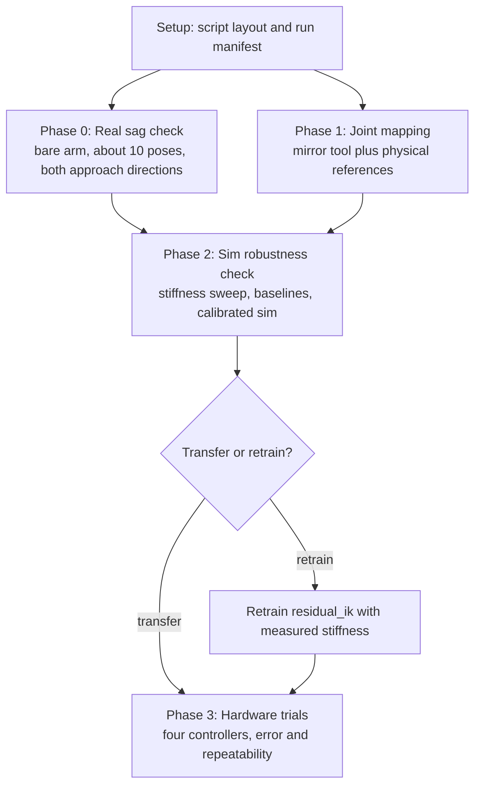

# Sim2Real Reach Transfer: Implementation Spec

## 0. Overall Goal and This Sub-Task

### Overall goal (the cube task)

The project's end goal is a policy that picks up cubes of different weights and places them at a specified location, and a paper showing where calculated dynamics stop matching the real arm. Examples are slip with heavier cubes, gear friction, and motor torque limits.

The paper's main claim is a measurement of the gap: how and why predictions diverge from the real arm as the cubes get heavier. "Calculated dynamics" covers two models of different detail, and every effect is compared three ways:

1. **Hand-calculated model:** rigid links, gravity torque from known masses, a textbook friction rule for grip slip.
2. **Simulator (MuJoCo):** motor springs, contacts, friction cones. More detailed, but still built on assumptions.
3. **Real arm:** what actually happens.

The paper also aims to show as many concrete cases as possible where analytic models become hard to use. It does not claim that one controller type wins. Section 4 lists the cube-task work.

### This sub-task (simple reach on the real arm)

This spec covers only the first step: getting the existing simple reach policy working on the real arm. It has three jobs:

- **Build the infrastructure** the cube task reuses: script layout and run provenance, the real-robot backend, a trusted joint mapping, and the first actuator measurements.
- **Measure the bare-arm starting point:** real sag, and how four controllers perform on the real arm with no payload. This is the zero-mass point on the cube-weight curve.
- **Learn early whether the sim policy transfers,** and why or why not.

Anything that only matters once cubes are involved is deferred to section 4, so this sub-task stays small.

---

## 1. Where We Are and Where We Want to Go

### Where we are

We have a reach policy that works in simulation. Given a 3D target, it moves the SO-101 gripper site (`gripper_site`) there and holds it still. The best version is the `residual_ik` preset in `checkpoints/reach_1m_residual_ik`. It works in two parts:

- At the start of each episode, inverse kinematics (IK) computes the joint angles that would put the gripper on the target if the arm were perfectly rigid.
- The policy then adds a small correction to each joint, at most ±0.1 rad. The correction compensates for gravity sag: the arm's position servos settle slightly short of their command because the links are heavy.

In simulation the policy holds the gripper 0.3 mm from the target on average, 0.7 mm at the 95th percentile. IK alone, with no correction, is off by 10.3 mm. With randomized motor gains and payload, the policy still holds 1.0 mm (see `experiments/2026-10-12_sac_1m_presets/README.md`).

The caveat is that the simulator's motor stiffness values are placeholders. The MJCF uses `kp="20"` for the shoulder and elbow, `6` for wrist flex, and `4` for wrist roll, and none of these were measured. LeRobot writes `P_Coefficient=16, I=0, D=32` to every STS3215 when it connects, and we don't know how much sag that produces. There is no real-robot code yet: `src/rbe_501_so101/hardware/` is empty, and the only hardware tool is `scripts/jog.py`.

### What we don't know yet

- **How much the real arm sags.** If it sags much more than the sim, the policy's ±0.1 rad correction limit may not be enough.
- **How the policy corrects sag.** It could be memorizing a fixed correction for each pose (feedforward), which only works if the real motors match the sim. Or it could be watching the remaining error and adjusting (feedback), which works regardless of motor strength. The policy's observation includes everything feedback needs: the gap between commanded and measured joint angles (the sag itself), the target error, and its previous action. The small drop in performance under randomized gains suggests feedback, but this is untested.
- **Whether a simple classical controller does just as well.** The servo encoders sit on the output shaft, so they see the sag. A controller that keeps nudging each joint's command until its encoder reads the right angle (integral control) needs no model at all.

### Where we want to go

At the end of this sub-task we can say, with measured numbers:

1. how much the real bare arm sags, and whether that sag depends on approach direction (gear friction);
2. whether the sim policy corrects sag by feedforward or feedback, and how its error changes as motor stiffness moves away from the sim's;
3. how four controllers compare on the real arm: IK hold (no correction), gravity compensation (model-based), integral control (model-free feedback), and the RL policy;
4. how repeatable the real arm is at a fixed target.

---

## 2. How the Feature Works

### Phases



Setup comes first. Phases 0 and 1 don't depend on each other: Phase 0 works in LeRobot's own degrees and only needs the difference between commanded and measured angles, so it doesn't need the joint mapping. The real backend used in Phase 3 can be written at any time, since it needs no measured values.

### Error budget

Every tolerance below comes from millimeters at the gripper, not from round numbers of degrees. With about 0.3 m between the shoulder and the gripper, 1° at the shoulder moves the gripper about 5 mm. The sag being studied is about 10 mm in sim.

- **Encoder floor.** 4096 counts per turn is 0.088° per count, about 0.5 mm at the gripper. The servo firmware also ignores errors of a count or two (its dead zone). Real holding error therefore can't go much below about 1 mm, and the sim's 0.3 mm is not a realistic target.
- **Joint mapping.** A mapping offset doesn't change the error computed from the encoders, since the target and the arm are both computed with the same mapping. It does change where the gripper really is, and the gravity torque used by the gravity-compensation controller. The mapping tolerance is 0.5° per joint, about 2.5 mm at the gripper, well under the 10 mm effect.
- **Comparisons.** A difference between two controllers is only reported if it is larger than the spread across repeated runs.

### Setup: script layout and run provenance

All sim2real scripts live in `scripts/sim2real/`, split into `collect/` (talks to the arm and produces data we can't regenerate) and `analyze/` (sim or offline only). Every script writes a manifest into each output folder: script, arguments, git commit, uncommitted changes, package versions, and robot ID. Any number in the report then traces back to the exact script and code version that produced it. Details are in 3.0.

### Phase 0: Real sag check

This is one afternoon on the real arm, done before any sim analysis, because its answer can change the rest of the plan.

- About 10 poses spread across the workspace, chosen by jogging the arm by hand and recording them in LeRobot degrees. The poses stay clear of the table and the joint limits.
- Each pose is approached twice: once from above (every joint starts a few degrees past the goal and comes down to it) and once from below.
- At each arrival: wait to settle, average several readings, and record the commanded and measured angles, motor temperature, and supply voltage.
- The servo settings LeRobot wrote are read back and saved with the session.

Three results come out:

1. **Sag per joint** (commanded minus measured), the main number.
2. **Hysteresis per joint:** the difference between arriving from above and from below. Large hysteresis means gear friction, not spring-like sag, is what holds the arm. That is already a finding: the sim has no friction.
3. **Effective stiffness per joint,** fitted after Phase 1 (see Phase 2), from sag against the gravity torque at each pose.

**Early warning:** if real sag on any joint is larger than about half the policy's ±0.1 rad correction limit, the policy will likely run out of room. In that case plan on retraining.

### Phase 1: Joint mapping

LeRobot reports arm joints in degrees, with 0° at the middle of the range recorded during calibration. The gripper is reported on a 0 to 100 scale. The simulator uses radians, with 0 wherever the URDF defines it. These may not line up. Our calibration file already shows different ranges: `shoulder_lift` covers about ±88° on the real arm but ±100° in the sim, and `wrist_flex` covers about ±105° real versus ±95° sim. LeRobot's degree scale is fixed at 360/4095 per count, so these are differences in joint limits, not in scale.

Two steps:

- **Sign check with the mirror tool.** Torque off, read the real joint angles, convert them, and draw the matching pose in the MuJoCo viewer live. Move each joint by hand and confirm the sim joint turns the same way. This catches sign errors and gross offsets, but judging angles by eye in a viewer is only good to a few degrees.
- **Offsets from physical references.** Measure each offset against something physical rather than by eye. For example, place a digital level on the upper arm and on the forearm, set each link horizontal, and compare the reading with the sim angle at which that link is horizontal. Where a level doesn't fit, use the joint's mechanical stops or a printed alignment jig.

The resulting signs and offsets go in config. The mirror tool is reused for the torque-off dry run in Phase 3.

### Phase 2: Sim robustness check

This phase answers what the sim policy depends on, using the Phase 0 numbers. It replaces a longer list of policy-interpretation analyses that are no longer needed.

**Training assumptions worth knowing about.** These come from the code and config. Each one gets an entry in `reports/assumptions.md` saying whether it was tested and what happened.

- **Motor stiffness:** each servo is a spring with the MJCF's `kp`, so sag is roughly gravity torque divided by `kp`.
- **Correction headroom:** the correction is capped at ±0.1 rad.
- **No friction, deadband, or backlash:** the MJCF has no `frictionloss` or armature.
- **Ideal timing:** each control step is exactly 33 ms, with no delay between command and motion.
- **Perfect sensing:** joint angles are exact, velocities have no noise, and the gripper position comes from exact forward kinematics.
- **Fixed conditions:** payload randomized only from 0 to 50 g, gripper held at 40°, every episode starting at rest at home `(0, -20, 40, 15, 0, 40)` degrees and lasting 150 steps (5 s). Observations are normalized with statistics collected in sim (`vecnormalize.pkl`).
- **Start state:** in sim, every episode starts with the arm exactly at its command (no sag yet). The real arm starts already sagged. This is logged as a known difference.

**Four controllers,** all evaluated with the same targets and metrics:

- **IK hold:** solve IK and hold that pose, no correction. Already exists.
- **Gravity compensation:** command `q_ik + gravity_torque(q_ik) / kp`, with the gravity torque from the model. With the sim's own `kp` it uses the exact model, so in nominal sim it is a best-case baseline that can't fail. Its value comes when `kp` is wrong.
- **Integral control:** after reaching the IK pose, keep adding a small fraction of each joint's remaining error (`q_ik - q_measured`) to that joint's command. No model needed. Its correction is capped at the same ±0.1 rad as the policy, for a fair comparison.
- **RL policy:** the existing `residual_ik` checkpoint, unchanged.

**Analyses:**

- **Stiffness sweep (feedforward or feedback?).** Scale every motor's `kp` from 0.3 to 3 times nominal and plot each controller's holding error. If the RL policy's error stays flat like integral control, it is using feedback. If it grows with the mismatch like gravity compensation does, it is mostly feedforward. The plot also shows the stiffness range over which the policy still works. The Phase 0 measured stiffness is marked on it.
- **Correction headroom.** At each stiffness, the fraction of episodes where the policy's correction hits its ±0.1 rad cap.
- **Sensing and timing.** Joint readings rounded to encoder resolution, velocity computed by differencing the rounded positions (as the real backend will do), and a delay of 0 or 1 control step. Run once alone and once combined with the measured stiffness.
- **Reduced speed.** The hardware runs the command rate slower at first. The slower approach changes what the policy sees on the way in, and it may not settle before the scored holding window (the last 30 steps). Check both at the hardware speed setting.
- **Calibrated sim.** Write the Phase 0 stiffness (and friction, if hysteresis was large) into a calibration file loaded on top of the MJCF, so the placeholder model stays the default. Re-run the four controllers. These numbers are the sim's prediction for Phase 3. Check the calibrated sim against Phase 0 by commanding the same poses and comparing sag joint by joint.

### Decision: transfer or retrain

In the calibrated sim with sensing and timing effects combined, the existing policy transfers if both hold:

- its mean holding error is at most `transfer_max_mean_m` (default 2 mm, about the encoder floor plus margin), and it beats IK hold by more than the spread across seeds;
- its correction hits the cap in fewer than `max_saturation_fraction` of episodes (default 5%).

Otherwise, train `residual_ik_calibrated`: the same preset, with motor stiffness randomized around the measured per-joint values, plus encoder rounding and a delay of 0 to 1 step. Then re-run Phase 2 on the new checkpoint. Either way, Phase 3 runs, because the sim can't capture everything.

### Phase 3: Hardware trials

A real backend plugs the physical arm into the existing reach environment, so the same policies and evaluation code run unchanged. Trials run in this order, each one confirming the setup before the next adds risk:

1. **Torque-off dry run** with the mirror tool.
2. **IK hold at reduced speed** on a fixed set of targets. This is the real sag at those targets.
3. **Gravity compensation** with the measured stiffness.
4. **Integral control.**
5. **The RL policy** (existing or retrained).

**What is measured:**

- **Encoder-based error:** distance from the gripper position (computed from measured joint angles) to the target, over the holding window. This is what the policy sees.
- **Repeatability:** each controller goes to the same 3 targets 10 times each, starting from home. Report the spread of the final positions.
- **External accuracy:** measured with the camera if it is set up by then (section 4 covers the camera work). Without the camera, external accuracy is reported as not measured yet. A ruler is too coarse for millimeter-level comparisons.

### Capturing findings for the report

The end product is a written report, so every phase records what it learns in the top-level `reports/` folder as it goes, matching `AGENTS.md`.

- **`experiments/`** stays the raw, reproducible record of each run: config, eval report, monitor CSVs, plots, and the run manifest.
- **`reports/`** is the curated narrative: findings, sim-versus-real differences, and final figures. It links to `experiments/` and `data/` for evidence instead of copying them.

The core is a **differences log** with one entry for every way the sim and the real arm turn out to differ, including differences that don't matter, because "we checked, and it doesn't affect the result" is a result too. A phase is not done until its findings are in `reports/`.

---

## 3. Implementation Details

All new code follows `AGENTS.md`:

- **Tests first:** write the test, see it fail, implement, see it pass.
- **Small functions:** under 25 lines, with docstrings.
- **Typed data:** dataclasses instead of loose dicts.
- **Protocols at boundaries.** Hardware is always reached through a protocol, so tests use a fake arm and never need the robot.
- **No magic numbers:** constants live in `src/rbe_501_so101/config.py`.

### 3.0 Setup: script layout and run provenance

This is done before any phase starts.

**Script layout:**

```
scripts/sim2real/
  README.md            index of every script: phase, robot or sim, output location
  collect/             talks to the physical arm; its output is irreplaceable raw data
    jog.py             moved from scripts/jog.py
    sag_check.py       Phase 0
    mirror_arm.py      Phase 1, and the Phase 3 dry run
    run_policy_real.py Phase 3
  analyze/             sim or offline only; can be rerun from saved data at any time
    analyze_sag.py     Phase 0 results mapped into sim terms, stiffness fit, calibration file
    robustness_sweep.py Phase 2
```

Scripts import shared code from `rbe_501_so101` only, never from each other, so any code two scripts need goes into `src/`. Moving `jog.py` also updates its references in `README.md` and this doc.

**`scripts/sim2real/README.md`** has one row per script: its name, phase, whether it needs the arm, what it writes and where, and an example command. A script is not done until its row exists.

**Run manifest** (`src/rbe_501_so101/provenance.py`). Every sim2real script writes a `manifest.json` into each output folder it creates:

```python
@dataclass(frozen=True)
class PackageVersion:
    """One installed package and its version."""

    name: str
    version: str


@dataclass(frozen=True)
class RunManifest:
    """Where one output folder came from: script, arguments, code version, and environment."""

    script: str                                # path relative to the repo root
    argv: tuple[str, ...]
    git_commit: str
    git_dirty: bool
    started_at: datetime
    finished_at: datetime | None
    package_versions: tuple[PackageVersion, ...]  # rbe_501_so101, mujoco, lerobot, torch
    robot_id: str | None                       # set by collect/ scripts only
```

- `RunManifest.capture(robot_id=None)` fills everything except `finished_at` at script start. `finalize()` sets `finished_at` when the script exits normally, so a folder without it marks a run that crashed or was aborted.
- When the working tree is dirty, the output of `git diff HEAD` is saved next to the manifest as `uncommitted.patch`.
- `collect/` scripts refuse to run on a dirty tree unless `--allow-dirty` is given, because hardware sessions are expensive to repeat.
- Servo settings are saved in the session data (3.3), not the manifest. The manifest records which run produced the data, not what was measured.

**Tests (`tests/test_provenance.py`):**

- A manifest round-trips through JSON.
- `capture` records the script path relative to the repo root and the exact `argv`.
- On a dirty tree, `uncommitted.patch` is written and `git_dirty` is true. Use a temporary git repo in the test.
- A `collect/` entry point exits with an error on a dirty tree without `--allow-dirty`.

**Done when:** the folder layout exists, `jog.py` has moved and still runs, the README index lists every planned script, and the manifest helper is tested and used by the first script that writes output.

### 3.1 New modules

- **`src/rbe_501_so101/provenance.py`:** `RunManifest` (3.0). At the package root because both hardware and sim scripts use it.
- **`src/rbe_501_so101/hardware/`**
  - `bus.py`: the `JointBus` protocol, `LeRobotJointBus` (an adapter over `SO101Follower`), and `FakeJointBus` for tests.
  - `joint_mapping.py`: `JointMap`, converting LeRobot degrees and the 0 to 100 gripper scale to sim radians and back.
  - `sag.py`: Phase 0 data types, `SagRepository`, and the stiffness and friction fits.
  - `real_backend.py`: `LeRobotSo101Backend`, which implements `RobotBackend`.
  - `safety.py`: `SafetyMonitor`, which checks commanded poses, motor temperature and load, and loop overruns.
- **`src/rbe_501_so101/envs/`**
  - `perturbed_backend.py`: `PerturbedBackend`, a `RobotBackend` wrapper that adds encoder rounding and command delay.
  - `calibration.py`: `ActuatorCalibration`, which loads measured stiffness and friction and applies them to the MuJoCo model.
- **`src/rbe_501_so101/rl/`**
  - `policies.py` (existing): add `GravityCompPolicy` and `JointIntegralPolicy`.
  - `robustness.py`: the stiffness sweep, the saturation count, and their result types.

### 3.2 Configuration additions (`config.py`)

```python
@dataclass(frozen=True)
class JointMappingEntry:
    """How one LeRobot joint reading maps onto the matching sim joint."""

    sign: float = 1.0
    offset_rad: float = 0.0


@dataclass(frozen=True)
class HardwareConfig:
    """Physical SO-101 connection, unit mapping, and motion limits."""

    port: str = "/dev/so101_follower"
    robot_id: str = "rbe501_follower"
    max_relative_target_deg: float = 10.0
    speed_scale: float = 0.5
    home_ramp_s: float = 3.0
    settle_s: float = 1.0
    limit_margin_rad: float = 0.15
    joint_map: tuple[JointMappingEntry, ...] = tuple(JointMappingEntry() for _ in range(5))
    gripper_percent_range: tuple[float, float] = (0.0, 100.0)
    mapping_tolerance_deg: float = 0.5


@dataclass(frozen=True)
class SafetyConfig:
    """Abort thresholds checked on every hardware control step."""

    max_temperature_c: float = 55.0
    max_load_fraction: float = 0.8
    max_consecutive_overruns: int = 3
    table_clearance_m: float = 0.02
    status_check_every_steps: int = 10


@dataclass(frozen=True)
class SagCheckConfig:
    """Phase 0: how each recorded pose is approached and sampled."""

    poses_path: Path = PROJECT_ROOT / "data" / "sag_check" / "poses.json"
    approach_offset_deg: float = 5.0
    settle_s: float = 2.0
    n_reads: int = 20


@dataclass(frozen=True)
class PerturbationConfig:
    """Sensing and timing effects applied around a simulated backend."""

    delay_steps: int = 0
    quantization_rad: float = 0.0


ENCODER_COUNTS_PER_REV = 4096


@dataclass(frozen=True)
class IntegralControlConfig:
    """Model-free baseline: fraction of the remaining joint error added to the command each step."""

    gain: float = 0.2


@dataclass(frozen=True)
class RobustnessConfig:
    """Phase 2 sweep grid and the transfer-or-retrain thresholds."""

    kp_scales: tuple[float, ...] = (0.3, 0.5, 0.75, 1.0, 1.5, 2.0, 3.0)
    delay_steps: tuple[int, ...] = (0, 1)
    quantization_rad: float = 2 * pi / ENCODER_COUNTS_PER_REV
    episodes_per_point: int = 20
    saturation_threshold: float = 0.95
    transfer_max_mean_m: float = 0.002
    max_saturation_fraction: float = 0.05
```

`SimConfig` gains `calibration_path: Path | None = None`. When it is set, `MujocoSo101Backend` applies `ActuatorCalibration` after `_apply_torque_caps()`, and `NominalDynamics.capture` runs after that, so randomization scales around the measured values. The placeholder MJCF stays the default.

`stall_torque_nm = 2.9` matches the 12 V STS3215. The 7.4 V variant is rated at roughly 1.9 N·m. Check which servo and supply the arm uses and record it in `reports/differences.md`.

### 3.3 Phase 0: Real sag check

**`JointBus` protocol** (`hardware/bus.py`):

```python
class JointBus(Protocol):
    """Minimal physical-arm interface the rest of the code depends on."""

    def read_positions(self) -> dict[str, float]: ...
    def read_status(self) -> tuple[MotorStatus, ...]: ...
    def read_settings(self) -> tuple[MotorSettings, ...]: ...
    def send_positions(self, goal: dict[str, float]) -> dict[str, float]: ...
    def set_torque(self, enabled: bool) -> None: ...
    def close(self) -> None: ...
```

The `dict[str, float]` joint readings mirror LeRobot's `"<joint>.pos"` interface at the boundary. Inside our code they become arrays as soon as `JointMap` converts them.

`LeRobotJointBus` wraps `SO101Follower`:

- `read_positions` uses `get_observation()`.
- `read_status` reads `Present_Temperature`, `Present_Voltage`, and `Present_Load` with `bus.sync_read`.
- `read_settings` reads back every register LeRobot configures, not just the gains: `P_Coefficient`, `I_Coefficient`, `D_Coefficient`, `Acceleration`, `Maximum_Acceleration`, `Max_Torque_Limit`, `Protection_Current`, and `Overload_Torque`.
- `send_positions` uses `send_action()`, which keeps `max_relative_target` in force. Note that LeRobot clips each goal relative to the present (sagged) position, and does an extra position read on every call.

**Data types** (`hardware/sag.py`):

```python
@dataclass(frozen=True)
class MotorStatus:
    """Readings that change how strong a motor is: temperature, voltage, load."""

    name: str
    temperature_c: float
    voltage_v: float
    load_fraction: float


@dataclass(frozen=True)
class MotorSettings:
    """Servo registers that affect sag, read back from the motor."""

    name: str
    p: int
    i: int
    d: int
    acceleration: int
    max_acceleration: int
    max_torque_limit: int
    protection_current: int
    overload_torque: int


@dataclass(frozen=True)
class SagSample:
    """One settled arrival at a pose, in LeRobot degrees."""

    pose_id: int
    approach: Literal["above", "below"]
    goal_deg: tuple[float, ...]
    measured_deg: tuple[float, ...]
    measured_std_deg: tuple[float, ...]
    status: tuple[MotorStatus, ...]


@dataclass(frozen=True)
class SagSession:
    """One Phase 0 session: servo settings plus every sample."""

    robot_id: str
    settings: tuple[MotorSettings, ...]
    samples: tuple[SagSample, ...]
```

**`SagRepository`** saves and loads sessions under `data/sag_check/<date>_<robot_id>/session.json`, next to the run manifest, following the `CheckpointRepository` pattern.

**`scripts/sim2real/collect/sag_check.py`:**

- `record-poses`: torque off, and a keypress saves the current pose to `poses_path`. This is how the 10 poses are chosen.
- `run`: for each pose, ramp to a point `approach_offset_deg` above it on every joint, step to the pose, wait `settle_s`, and average `n_reads` readings. Repeat from below. The pose order is fixed, so a temperature drift during the session shows up as a trend.
- Ramps to rest before turning torque off at the end.

**Fits** (`hardware/sag.py`, used by `analyze/analyze_sag.py` once the Phase 1 mapping exists):

- `sag_by_joint(session)`: mean sag per joint and pose, averaged over both approach directions.
- `hysteresis_by_joint(session)`: half the difference between arrivals from above and from below. Physically, this is about the Coulomb friction torque divided by stiffness.
- `fit_compliance(session, joint_map, model)`: for each joint, fits `sag = c * gravity_torque` by least squares, with the gravity torque from `data.qfrc_bias` at the measured pose (velocities zeroed, `mj_forward` called). It reports `c` with a 95% confidence interval and `kp = 1 / c`. A joint whose gravity torque barely varies across the poses (wrist roll, for example) is reported as not identifiable instead of producing a noisy `kp`.
- `friction_torque(hysteresis, kp)`: `kp * hysteresis`, the starting value for `dof_frictionloss`.

`analyze_sag.py` writes an `ActuatorCalibration` file and an experiment folder with per-joint sag, hysteresis, and fitted stiffness against the MJCF value.

**Tests (`tests/test_sag.py`):**

- The repository round-trips a session through JSON.
- `sag_by_joint` and `hysteresis_by_joint` give the known values on hand-built samples.
- `fit_compliance` recovers a known stiffness from a fake arm: a MuJoCo backend with scaled `kp`, added `frictionloss`, and encoder rounding. The 95% interval contains the true value. The fake has friction and rounding so the fit is tested on imperfect data, not just on the model it assumes.
- A joint with near-constant gravity torque is reported as not identifiable.
- `sag_check run` against `FakeJointBus` approaches each pose from both sides in the configured order.

**Done when:** a session with all poses and both approach directions is saved, the experiment folder reports sag, hysteresis, and stiffness (with confidence intervals) per joint, and the early-warning check (sag against the ±0.1 rad cap) is stated in its README.

### 3.4 Phase 1: Joint mapping

**`JointMap`** (`hardware/joint_mapping.py`):

- `to_sim(reading: dict[str, float]) -> np.ndarray`: LeRobot degrees and gripper percent in, 6 sim radians out. Arm joints use `sign * deg2rad(deg) + offset_rad`. The gripper is mapped linearly from `gripper_percent_range` onto the sim gripper joint range, which is read from the model.
- `to_lerobot(q_rad: np.ndarray) -> dict[str, float]`: the exact inverse, with keys in the `"<joint>.pos"` form that `send_action` expects.

**`scripts/sim2real/collect/mirror_arm.py`:**

- Connects with `calibrate=False` and turns torque off.
- Runs a 30 Hz loop: read positions, convert with `JointMap.to_sim`, write them into `data.qpos`, call `mj_kinematics`, and sync the passive viewer.
- Prints a per-joint table of LeRobot degrees and sim degrees.
- A keypress records the current pose and an optional reference note (for example "upper arm level") to a JSON file.

**Offset procedure.** For each joint, place the arm at a physical reference (a link level, measured with a digital level, or a mechanical stop), record the LeRobot reading with `mirror_arm.py`, and compute the offset from the sim angle at that same reference. Record each reference and reading in the mapping note so the offsets can be rechecked.

**Tests (`tests/test_joint_mapping.py`):**

- A round trip `to_lerobot(to_sim(x))` returns `x`.
- A sign of -1 flips direction, and the offset shifts zero.
- Gripper 0 and 100 map to the ends of the sim gripper range.
- A missing joint key raises a clear error.

**Done when:** every joint's sign is confirmed with the mirror tool, every offset comes from a recorded physical reference, and re-measuring at a second reference agrees within `mapping_tolerance_deg`. The final values are in config, and the procedure and readings are in `reports/differences.md`.

### 3.5 Phase 2: Sim robustness check

**`PerturbedBackend`** (`envs/perturbed_backend.py`) wraps any `RobotBackend`:

- **Delay:** `apply_delta` pushes into a FIFO queue `delay_steps` long. Each `step()` sends the oldest entry to the inner backend.
- **Encoder rounding:** `step()` rounds `qpos` to `quantization_rad`, and `qvel` is computed by differencing the rounded positions over the control period, the same way the real backend computes it.
- **Gripper position:** `tcp_pos` is recomputed by forward kinematics from the rounded `qpos`, using `PositionIKSolver.forward`, matching what the real backend reports.
- **Delegation:** `joint_limits`, `close`, and the optional `TargetMarker` and `Renderable` capabilities pass through to the inner backend.

A delay shorter than one 33 ms control step can't be represented this way. That is acceptable for holding still at a target. Finer delay modeling is deferred to the cube task (section 4).

**Stiffness scaling** reuses the existing `DynamicsRandomizationConfig` with a zero-width range, `kp_scale_range=(s, s)`, so no new backend code is needed.

**`GravityCompPolicy`** (`rl/policies.py`):

- On reset, it solves IK and computes `q_goal = q_ik + clip(tau_g(q_ik) / kp, ±residual_max_rad)`. The gravity torque at `q_ik` is already the torque at the pose we want to hold, so no iteration is needed.
- It drives the command toward `q_goal` at the same rate limit as `IKHoldPolicy`.
- `kp` comes from the model by default, or from an `ActuatorCalibration`.

**`JointIntegralPolicy`** (`rl/policies.py`):

- On reset, it solves IK and zeroes its correction `z`.
- Each step, once the command has reached the IK pose, it adds `gain * (q_ik - qpos)` to `z`, clipped to ±`residual_max_rad`, and drives the command toward `q_ik + z` at the same rate limit.
- It uses only measured joint angles: no model, no stiffness.

**`rl/robustness.py`:**

- `SweepResult`: controller name, parameter name and value, mean and p95 holding error from `rl.evaluation.summarize`, and the saturation fraction.
- `run_stiffness_sweep(repo, seed, cfg) -> list[SweepResult]`: one env per `kp` scale, built with `make_eval_env` from the checkpoint's saved preset, evaluating all four controllers on the same targets.
- `saturation_fraction(actions, threshold) -> float`: the fraction of holding-window steps where any action component exceeds `threshold` in magnitude.
- `transfer_decision(results, cfg) -> TransferDecision`: applies the decision rule and returns the verdict with its reasons.

**`scripts/sim2real/analyze/robustness_sweep.py`** writes `experiments/<date>_reach_robustness/`:

- `report.json` with every `SweepResult` and the `TransferDecision`;
- the stiffness sweep plot (holding error against `kp` scale, one line per controller, Phase 0 stiffness marked);
- the saturation plot;
- the sensing and timing results, alone and combined with the calibrated sim;
- the reduced-speed check;
- the calibrated-sim check against Phase 0 sag;
- `README.md` stating whether the policy behaves like feedback or feedforward, the stiffness range over which it works, and the transfer-or-retrain verdict.

`rl/cli.py` gains `--calibration PATH` and `--perturb` so the same settings can be evaluated from the existing CLI. A new `PRESETS["residual_ik_calibrated"]` copies `residual_ik` and adds stiffness randomization around the calibration, encoder rounding, and a 0 to 1 step delay. It is only trained if the decision says so.

**Tests:**

- `PerturbedBackend` with `delay_steps=2` applies a delta exactly 2 steps later.
- Encoder rounding snaps readings to the grid, and `qvel` equals the difference of rounded positions divided by the period.
- The recomputed gripper position matches forward kinematics.
- `ActuatorCalibration.apply` changes exactly the intended model fields, and `calibration_path=None` behaves identically to today (a regression test against `tests/test_backend.py`).
- In the nominal sim, `GravityCompPolicy` and `JointIntegralPolicy` each beat `IKHoldPolicy` on mean holding error.
- At `kp` scale 0.5, `JointIntegralPolicy` still beats `IKHoldPolicy`, while `GravityCompPolicy` with nominal `kp` does worse than at scale 1.0. This confirms the sweep separates feedback from feedforward.
- `run_stiffness_sweep` on a 1-point grid returns one result per controller with finite errors (fast: 1 episode, few steps).
- `transfer_decision` returns the expected verdict on hand-built results.

**Done when:** the experiment README answers feedback or feedforward, gives the working stiffness range with the measured stiffness marked, and states the transfer-or-retrain verdict with reasons. If the verdict is retrain, `residual_ik_calibrated` is trained and passes the same check.

### 3.6 Phase 3: Real backend and hardware trials

**`LeRobotSo101Backend`** (`hardware/real_backend.py`) implements `RobotBackend` on a `JointBus`, a `JointMap`, and a `SafetyMonitor`:

- **`reset(rng)`:** turns torque on, ramps the command from the current pose to home over `home_ramp_s`, waits `settle_s`, and returns the state.
- **`apply_delta(delta)`:** integrates `q_cmd` and clips it to the tighter of the sim and real limits, minus `limit_margin_rad`.
- **`step()`:**
  - checks the command with the `SafetyMonitor`, then sends `to_lerobot(q_cmd)`;
  - sleeps until the 33 ms period ends, using a monotonic deadline that does not drift;
  - reads positions and computes `qvel` by differencing positions over the period, matching `PerturbedBackend`;
  - computes `tcp_pos` by forward kinematics.

  If the loop overruns the period, it logs and counts the overrun. Each step makes several bus transactions (LeRobot's `send_action` adds its own position read), so the overrun count is reported for every session.
- **`joint_limits()`:** the clipped limits.
- **`close()`:** ramps to a rest pose before turning torque off, because cutting torque at an arbitrary pose drops the arm.

**`SafetyMonitor`** (`hardware/safety.py`):

- Rejects any commanded pose where forward kinematics puts a link closer than `table_clearance_m` to the table, using the MuJoCo model.
- Every `status_check_every_steps` steps, reads `MotorStatus` and aborts above `max_temperature_c` or `max_load_fraction`. An overloaded servo cuts its own torque and the arm drops, so this check stops the run before that happens.
- Aborts after `max_consecutive_overruns` overruns in a row.
- On abort: hold the current command, then ramp to rest.

**`scripts/sim2real/collect/run_policy_real.py`:**

- Options: `--policy {ik_hold, gravity_comp, integral, trained}`, `--model-dir`, `--calibration`, `--seed`, `--targets targets.json`, `--repeats`, `--speed-scale`.
- The trained policy loads `vecnormalize.pkl` with its statistics frozen (`training=False`).
- Targets are given in the sim world frame, with `robot_mount` assumed at the same world pose as in the MJCF. That assumption only affects external accuracy, which is deferred.
- Each episode logs per-step states, actions, motor status, and the encoder-based gripper error.
- Results go to `experiments/<date>_real_reach/`, with the manifest.
- A physical power switch within reach of the operator is the e-stop. A keypress triggers the software abort.

**Tests**, all with `FakeJointBus`:

- `step()` sends the mapped command and respects the period, using an injected clock.
- `apply_delta` clips to the tighter limits minus the margin.
- `reset` ramps monotonically to home.
- `close` ramps to rest before turning torque off.
- `SafetyMonitor` rejects a pose below the table clearance and aborts on high temperature, high load, and repeated overruns.
- `SO101ReachEnv(backend=LeRobotSo101Backend(...))` passes a short rollout with `IKHoldPolicy`.

**Done when:** each of the four controllers has run the fixed target set, plus 10 repeats at each of 3 targets. A README reports encoder-based error and repeatability per controller, next to the calibrated sim's predictions from Phase 2, and lists any failure seen only on hardware.

### 3.7 Safety rules for all hardware scripts

- Never change servo settings without recording them. `read_settings` saves them with every session, because sag depends on them.
- Keep `max_relative_target` on, so every move is ramped.
- Turn torque off only after ramping to the rest pose, or with the arm supported by hand.
- Run every commanded pose through `SafetyMonitor`.
- Keep the power switch within reach during every powered session.

### 3.8 Reports folder

```
reports/
  README.md          outline of the final report and status of each section
  differences.md     sim-vs-real differences log (one entry per difference)
  assumptions.md     each training assumption from Phase 2: how it was tested, result
  figures/           final, report-ready figures with stable file names
```

**`differences.md` entry format.** One heading per difference with a stable ID, so the report text can refer to it:

```markdown
### D-03: Shoulder-lift stiffness

- **Sub-task:** reach, Phase 0 (real sag check)
- **Sim:** kp = 20 N·m/rad (MJCF placeholder)
- **Real:** kp = 11.2 N·m/rad, 95% CI 10.1 to 12.4 (10 poses, both directions, P/I/D 16/0/32)
- **Hysteresis:** 0.6° (about 0.12 N·m of friction torque at this stiffness)
- **Impact:** at 0.55x nominal stiffness the RL policy's mean error rises from 0.3 to X mm (Phase 2 sweep)
- **Action:** written into the calibration file
- **Evidence:** [session](../data/sag_check/...), [sweep](../experiments/.../kp_sweep.png)
```

The numbers above are illustrative, not measured.

**Figures.** Each analyze script takes a `--report-figures` flag that also writes its main plots into `reports/figures/` under stable names, for example `real_sag.png`, `kp_sweep.png`, and `real_reach_controllers.png`. Re-running an analysis then refreshes the report without anyone copying files by hand.

**Expected entries by phase:**

- **Phase 0:** sag, hysteresis, and stiffness per joint; servo variant and supply voltage.
- **Phase 1:** joint signs and offsets, the references used, and the joint-range differences.
- **Phase 2:** feedback or feedforward, the working stiffness range, sensitivity to encoder rounding and delay, the start-state difference, and the transfer decision.
- **Phase 3:** real error and repeatability per controller against the sim predictions, and any hardware-only failure.

---

## 4. Deferred to the Cube Task

These matter for the overall goal but not for a bare-arm reach. They are listed here so nothing gets lost, and each reuses the infrastructure from this sub-task.

### Effects the cube task should showcase

Each effect is compared three ways: hand-calculated model, simulator, and real arm.

| Effect | Hand model assumes | Likely real behavior |
|---|---|---|
| Sag with payload | Sag grows in proportion to load | Grows faster near the motor's torque limit |
| Gear friction | No friction | Final position depends on approach direction |
| Motor heating | Constant motor strength | Sag grows over repeated trials as motors warm |
| Torque limits and overload protection | Unlimited torque, or a hard cap | Servo cuts power when overloaded and the arm drops |
| Grip slip | Slip starts at a calculable mass (friction rule) | Starts earlier or later, depending on finger material and contact area |
| Cube rotating in the grip | Rigid grasp | Off-center grasps pivot under the cube's weight |
| Slip while moving | Static analysis is enough | Acceleration during transport adds load and causes slip mid-move |
| Release and placement | Cube lands where released | Tips, slides, or bounces |

Two confounds must be measured and subtracted: errors in the arm's built dimensions, and command delay.

### Deferred work

- **Payload ladder.** Repeat Phase 0 with cubes of each mass (for example 0, 50, 100, 200 g, up to whatever the gripper holds), and find the heaviest cube held without slipping. Plot error and success rate against mass in sim and on the real arm. Where the curves separate is the main result.
- **Feedforward against feedback across masses.** Run the Phase 2 comparison at each cube mass. Controllers that predict should degrade as the model drifts; controllers that correct should degrade less.
- **Joint feedback cannot see slip.** Integral control fixes arm sag from a heavy cube, but no joint encoder sees the cube slipping in the gripper. This separates arm effects from contact effects.
- **Dynamic actuator measurement, with payloads.** Step response, rotor inertia (MuJoCo armature), damping (fit `kv` directly, since `dampratio` is only converted at compile time), delays shorter than one control step, torque saturation, overload cutoff, and heating over repeated trials. Record temperature and voltage throughout.
- **Gripper and contact measurements.** Grip force against command (LeRobot limits the gripper to 50% torque), finger-to-cube friction from a tilt test, and each cube's mass. These feed the hand model's slip prediction, which is then compared with observed slip onset.
- **Hand-calculated model, written down.** IK, gravity compensation with the known cube mass, and a friction-cone grip check, specified clearly enough to point to the exact assumption that fails.
- **Camera measurement.** AprilTag tracking of the gripper and cube. First measure the camera's own error (move a tag by known amounts) and never claim differences smaller than it. Then:
  - measure the robot base pose in the world frame;
  - fit joint offsets and link-length errors from the camera-measured gripper positions at many poses (kinematic calibration), so build errors aren't mistaken for dynamics;
  - report external accuracy separately from repeatability.
  If the camera is ready during Phase 3, external accuracy for the reach controllers is added there.
- **Scope check.** Learning to grasp with RL is much harder than reaching. Seeding training with scripted IK demonstrations (as proposed in `docs/sim2real_action_plan.md`) is likely needed on a class timeline.
