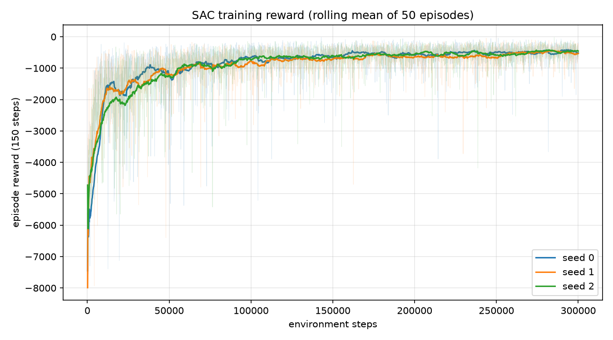
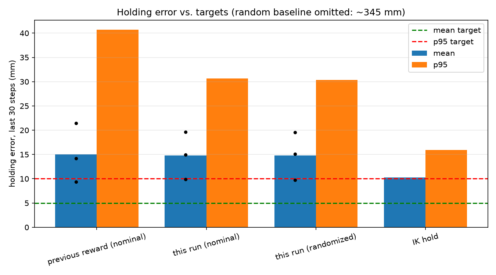

# 2026-10-11 — SAC, centimeter-scale reward + smoothness penalty

**Result: did not pass.** Nominal mean holding error 14.8 mm (target < 5 mm),
p95 30.7 mm (target < 10 mm). Still worse than the IK-hold baseline (10.3 mm).

## Conclusion in plain English

The simulation and learning pipeline works, but the policy has not learned
the skill this milestone is meant to prove.

- **What works.** The environment is stable, training is reproducible across
  seeds, and the policy clearly learns to reach: it starts about 38 cm from
  the target on average and ends up about 1.5 cm away, more than 20 times
  better than random actions. It also copes with randomized motor gains and
  payloads about as well as with the default robot.
- **What doesn't.** The point of the task is to make the arm *correct its own
  sag*: hold the gripper within millimeters of a target while gravity pulls
  it down. The policy doesn't do that. A much simpler controller that just
  solves inverse kinematics once and never corrects anything (IK hold) lands
  closer, at 10.3 mm versus 14.8 mm. The policy also doesn't hold still; it
  keeps making small corrections that don't converge.
- **What this run taught us.** Our first guess was that the reward gave too
  little signal in the last couple of centimeters. Rescaling it made the
  policy more consistent (far fewer bad episodes) but did not improve the
  typical error, so that guess was at most part of the story. The two
  remaining suspects are too little training (reward was still rising at the
  end) and the control interface making tiny, precise corrections hard to
  learn.

## The RL task

`SO101Reach-v0` is a deliberately simple "sanity" task that comes before
pick-and-place. If training failed on pick-and-place we couldn't tell whether
contact physics, grasping, rewards, or the pipeline was to blame. Reaching
removes everything except the pipeline and gravity.

- **Robot.** The simulated SO-101: five arm joints move the gripper; the
  gripper jaw is held fixed at 40°.
- **Physics.** Gravity compensation is off and each motor's torque is capped
  at the real servo's stall torque (2.9 Nm). The position-controlled motors
  therefore droop under load, like the real arm: a joint commanded to an angle
  settles slightly below it.
- **Goal.** Each episode samples a 3D target (shown as a red sphere) and the
  policy must move the gripper tip (`gripper_site`) to it and hold it there.
- **Targets.** Generated by picking random joint angles and computing where
  the gripper ends up, so every target is reachable by construction. A target
  is kept only if it is at least 2.5 cm above the table, 12–32 cm
  horizontally from the base axis, and the arm pose isn't touching anything.
- **Actions.** Five numbers in [−1, 1], one per arm joint, each scaled to a
  change of at most 0.07 rad (4°) in that joint's commanded angle. A zero
  action means "keep the current command."
- **Control rate.** Each step runs 33 physics substeps of 1 ms, about 30 Hz,
  close to how often the real servos can be commanded.
- **Observation.** 26 numbers: joint angles, joint speeds, commanded minus
  measured angles (how much the arm is sagging), the previous action, the
  gripper position, and the vector from the gripper to the target.
- **Episode.** Always 150 steps (about 5 s). It never ends early, so the
  policy must keep holding the target, not just touch it once.
- **Reward per step.**
  `-100·d + exp(-(d/5 mm)²) - 0.01·‖a‖² - 0.01·‖a - a_prev‖²`, where `d` is
  the gripper-to-target distance in meters. The first term rewards getting
  closer (worth 1 per centimeter). The second is a bonus that only pays out
  within about 1 cm, i.e. for correcting sag. The last two discourage large
  and jerky actions.
- **Algorithm.** SAC (Stable-Baselines3), 300k steps per seed, seeds 0, 1
  and 2, with observations normalized by `VecNormalize`.

## How we evaluate

- Each trained seed runs 20 episodes. Episode `i` always uses target seed
  `10000 + i`, so every policy and baseline faces exactly the same 20 targets.
- We measure the gripper-to-target distance over the **last 30 steps** of each
  episode (about the final second). This "holding window" ignores the
  approach and measures only how well the arm holds position.
- The policy runs deterministically (no exploration noise).
- We repeat the evaluation with randomized dynamics (motor stiffness and
  damping scaled 0.7–1.3×, up to 50 g extra payload) to check robustness.
  This is reported but not part of the pass/fail gate.

**The run passes only if all of these hold, under default dynamics:**

1. Mean holding error below 5 mm.
2. 95th-percentile holding error below 10 mm.
3. Every seed's mean below 5 mm, so one lucky seed can't carry the result.
4. Lower mean error than the IK-hold baseline.
5. Mean joint speed during the hold below 0.05 rad/s, i.e. the arm is
   actually still, not oscillating around the target.

## Why 5 mm

The threshold is chosen relative to the sag, not as an absolute precision
goal.

- Without gravity compensation, an arm that is commanded to the exact
  inverse-kinematics pose for a target settles about 10–12 mm short of it,
  because the motors only push back once gravity has pulled them away from
  their command. The IK-hold baseline measures this directly: 10.3 mm mean
  on our evaluation targets.
- A policy that only learns to reproduce IK-style poses will therefore score
  around 10 mm. To get **under 5 mm** it has to see the sag in its
  observations (commanded minus measured angles) and deliberately command
  past the target to cancel it. That closed-loop correction is the skill we
  need before grasping.
- The p95 limit (10 mm) stops a policy from passing on average while failing
  badly on some targets.

The sag size depends on motor stiffness values in the model that are still
placeholder guesses, so this milestone validates the learning pipeline, not
how well the result would transfer to the real robot.

## Baselines

Both baselines see the same 20 targets as the trained policy.

- **Random policy.** Uniformly random actions every step. A sanity floor: any
  policy that has learned anything should beat it by a wide margin. It scores
  about 345 mm.
- **IK hold.** At the start of each episode it solves inverse kinematics for
  the target (a numerical solver that searches for joint angles placing the
  gripper on the target), then moves the commanded joint angles toward that
  solution as fast as the action limit allows and stops there. It never
  looks at where the gripper actually ended up, so its error is exactly the
  sag. It is the "classical control without feedback" reference the learned
  policy has to beat.

## What changed vs. the previous run

- Reward: `-100·d + exp(-(d/5 mm)²) - 0.01·‖a‖² - 0.01·‖a - a_prev‖²`
  (previously `-d + exp(...) - 0.01·‖a‖²`, no smoothness term). Distance was
  previously in meters, so 1 cm of progress was worth only 0.01.
- Target sampler rejects poses that collide with the table; grasp cube removed
  from the reach scene.
- Trained on the RTX 5070 Ti (three seeds in parallel, ~37 min).
- Neither run trained with randomized dynamics.

Full settings are in `config.json`. Checkpoints: `checkpoints/reach_scaled/seed_{0,1,2}/`.

## Results (20 episodes per seed, last 30 of 150 steps)

| Policy | Mean (mm) | p95 (mm) | Per-seed mean (mm) | Hold speed (rad/s) |
|---|---|---|---|---|
| Previous reward, nominal | 15.0 | 40.7 | 14.2 / 9.4 / 21.4 | 0.087 |
| This run, nominal | 14.8 | 30.7 | 9.9 / 19.6 / 14.9 | 0.119 |
| This run, randomized dynamics | 14.8 | 30.4 | 9.8 / 19.5 / 15.1 | 0.134 |
| IK hold | 10.3 | 15.9 | — | 0.000 |
| Random | 345.1 | 535.3 | — | 0.408 |
| **Pass threshold** | **< 5** | **< 10** | **each < 5** | **< 0.05** |



Episode reward climbs quickly over the first 50k steps, then improves slowly.
It was still rising over the final 10% of training for all three seeds.



Every learned policy sits above both dashed target lines. Only the IK-hold
baseline gets close, and it still misses.

## Takeaways

- Robustness improved a lot (randomized-dynamics p95 dropped from 142.6 mm to
  30.4 mm), but typical error did not move.
- Holding joint speed went up: the policy hovers near the target instead of
  settling, which fails the 0.05 rad/s stillness criterion by itself.
- Seeds disagree by a factor of two (9.9 to 19.6 mm), so results are not yet
  stable enough to read much into a single seed.
- Training reward was still slowly rising at 300k steps.

## Next experiments

1. Train to 1M steps to test whether more training alone closes the gap.
2. Inspect holding-window actions to confirm oscillation, then try a larger
   smoothness weight or a smaller per-step action limit near the target.

## Reproduce

```bash
python scripts/train_reach.py --algo sac --timesteps 300000 --seeds 0 1 2 --model-dir checkpoints/reach_scaled
python scripts/train_reach.py --eval --model-dir checkpoints/reach_scaled --num-episodes 20 > logs/eval_report_scaled.raw
python scripts/report_experiment.py --name 2026-10-11_sac_scaled_reward --model-dir checkpoints/reach_scaled \
    --eval-report logs/eval_report_scaled.raw --baseline-report logs/eval_report.json
python scripts/run_policy.py --model-dir checkpoints/reach_scaled --seed 0   # watch the best seed
```
