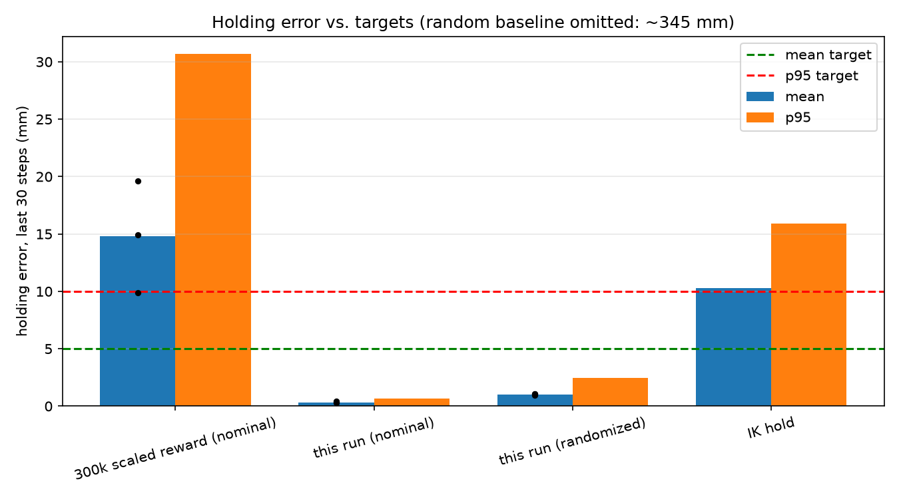

# 2026-10-12 — SAC, 1M steps, three presets

**Result: `residual_ik` passes every gate.** Nominal mean holding error 0.3 mm
(target < 5 mm), p95 0.7 mm (target < 10 mm), every seed under 0.5 mm, hold
speed 0.001 rad/s. That is about 30× better than the IK-hold baseline (10.3 mm).
The other two presets improve a lot on the previous run but do not pass.

Same task, evaluation protocol, and 20 targets as
[2026-10-11_sac_scaled_reward](../2026-10-11_sac_scaled_reward/README.md).
Each preset trained seeds 0, 1, 2 for 1M steps (9 runs in parallel on the
RTX 5070 Ti, about 2.6 h). Presets are defined in `PRESETS` in
`src/rbe_501_so101/config.py`; each subfolder has its config, eval report,
monitor CSVs, and plots.

## Presets

| Preset | Changes vs. the 300k scaled-reward run |
|---|---|
| `control_long` | 1M steps; 4 parallel envs, 2 gradient steps per vector step, 1M buffer. Env and reward unchanged. |
| `shaped` | `control_long` + cubic action map (`sign(a)·|a|³`), fine-error observation (target error clipped to ±2 cm, scaled to ±1), `ln(1 + d/1 mm)` penalty, near-target joint-velocity penalty (weight 2, radius 2 cm), SAC target entropy −10. |
| `residual_ik` | `shaped`, but IK is solved at reset and the action is a ±0.1 rad residual on the IK pose (command rate-limited to 0.07 rad/step; zero action = IK hold). The IK pose is observed. |

## Results (20 episodes per seed, last 30 of 150 steps)

| Policy | Mean (mm) | p95 (mm) | Per-seed mean (mm) | Hold speed (rad/s) | Passed |
|---|---|---|---|---|---|
| 300k scaled reward (previous) | 14.8 | 30.7 | 9.9 / 19.6 / 14.9 | 0.119 | no |
| `control_long` | 5.5 | 12.9 | 4.2 / 8.0 / 4.4 | 0.065 | no |
| `shaped` | 5.3 | 12.7 | 4.4 / 6.8 / 4.7 | 0.002 | no |
| **`residual_ik`** | **0.3** | **0.7** | **0.4 / 0.3 / 0.3** | **0.001** | **yes** |
| `residual_ik`, randomized dynamics | 1.0 | 2.4 | — | 0.001 | (not gated) |
| IK hold | 10.3 | 15.9 | — | 0.000 | — |
| **Pass threshold** | **< 5** | **< 10** | **each < 5** | **< 0.05** | |

Randomized dynamics (not gated): `control_long` 6.0 / 15.1 mm, `shaped` 6.2 / 16.1 mm.



## Takeaways

- **Training longer helped a lot on its own.** With the env unchanged, the
  mean dropped from 14.8 to 5.5 mm and the policy beat IK hold. It still
  fails p95, one seed (8.0 mm), and stillness (0.065 rad/s).
- **Shaping fixed stillness, not precision.** `shaped` holds still (0.002
  rad/s versus 0.065), which points to the velocity penalty plus lower
  exploration noise. Its error is about the same as `control_long`, and one
  seed (6.8 mm) and p95 still fail.
- **Residual IK is what clears the bar.** Starting from the IK pose, the
  policy only has to learn the sag correction, a small smooth function of
  pose. It is precise, consistent across seeds, and holds up under
  randomized gains and payload (1.0 mm).
- **Caveat.** The residual policy depends on an IK solve at reset, and sag
  depends on the placeholder motor stiffness values in the model. This
  validates the learning pipeline and the approach, not real-robot accuracy.
  The bundled changes in `shaped` were not ablated individually.

## Reproduce

```bash
for p in control_long shaped residual_ik; do
  python scripts/train_reach.py --preset $p --timesteps 1000000 --seeds 0 1 2 --model-dir checkpoints/reach_1m_$p
  python scripts/train_reach.py --eval --model-dir checkpoints/reach_1m_$p --num-episodes 20 > logs/eval_report_1m_$p.raw
  python scripts/report_experiment.py --name 2026-10-12_sac_1m_presets/$p --model-dir checkpoints/reach_1m_$p \
      --eval-report logs/eval_report_1m_$p.raw --baseline-report logs/eval_report_scaled.raw --baseline-label "300k scaled reward"
done
python scripts/run_policy.py --model-dir checkpoints/reach_1m_residual_ik --seed 0   # watch it
```
