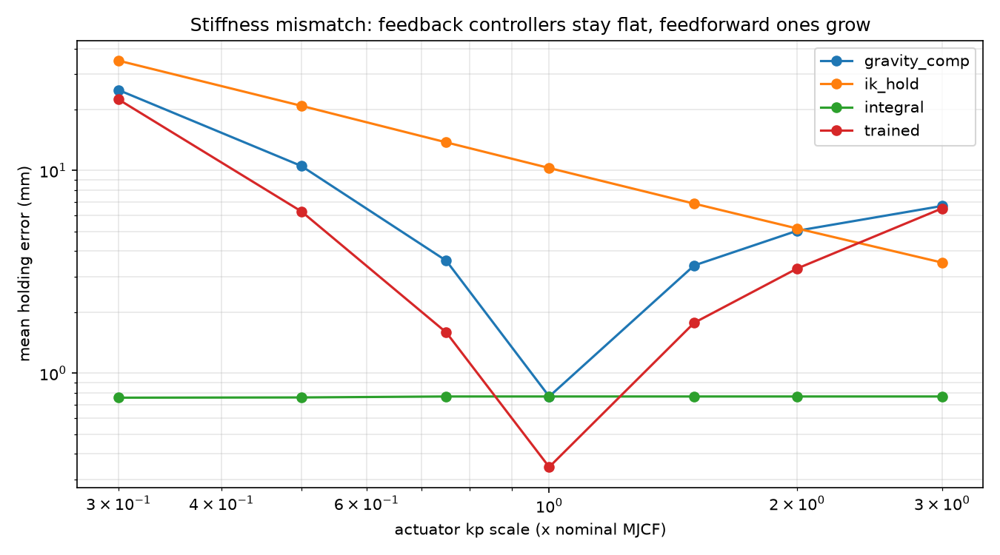

# Report: sim-to-real transfer of an SO-101 reach policy

Working outline of the class paper on sim2real and dynamics, with the status of each section. Raw results live in
`experiments/` and `data/`; this folder holds what the paper cites.

- [`differences.md`](differences.md): sim-vs-real differences log (stable IDs `D-xx`).
- [`assumptions.md`](assumptions.md): each training assumption, how it was tested, the result (IDs `A-xx`).
- `findings/`: short, dated write-ups of individual results for sharing. Start with the
  [2026-10-31 session recap](findings/2026-10-31_session_recap.md); also the
  [first real sag check](findings/2026-10-31_real_sag_check.md) and the [pose check](findings/2026-10-31_pose_check.md).
- `figures/`: report-ready figures with stable names, refreshed by the analyze scripts' `--report-figures` flag.

## Outline and status

| Section | Content | Status |
|---|---|---|
| 1. Introduction | Reach policy holds 0.3 mm in sim; does it transfer to a real SO-101? | outline |
| 2. System | SO-101, STS3215 servos, LeRobot bus, MuJoCo model, residual-IK SAC policy, three classical controllers (IK hold, gravity compensation, joint integral) | outline |
| 3. Method | Phase 0 sag check and stiffness fit, Phase 1 joint mapping, Phase 2 sim robustness sweep, Phase 3 hardware trials; run manifests for provenance | tooling done |
| 4.1 Real sag and stiffness | per-joint sag, hysteresis, fitted kp with 95% CI (`figures/real_sag.png`) | waiting on hardware session |
| 4.2 Joint mapping | signs, offsets, references, joint ranges (D-02) | ranges done; mapping waiting on hardware |
| 4.3 Sim robustness | feedback vs feedforward, working stiffness range, sensing/delay, verdict (`figures/kp_sweep.png`, `figures/saturation.png`) | provisional results (nominal kp) |
| 4.4 Hardware trials | encoder-based error and repeatability per controller vs calibrated-sim prediction | waiting on hardware; sim dry runs done |
| 5. Discussion | which differences mattered, modeling limits (D-03 friction creep), what the cube task should add | outline |

## Key findings so far (sim, then first hardware day)

1. The learned correction behaves like feedforward, not feedback: across stiffness 0.3x to 3x its error grows 65x,
   more than gravity compensation (32x), while joint integral control stays flat at 0.77 mm (D-08).
2. A single 33 ms delay plus encoder rounding raises the policy's error from 0.34 to 14.35 mm, worse than plain IK
   hold (D-05). Rounding alone triples it (D-04).
3. MuJoCo's `frictionloss` creeps to the same equilibrium from both sides, so the simulator cannot show the
   lasting hysteresis that gear friction produces (D-03).
4. About 5% of training configurations need elbow or shoulder-lift angles the real arm cannot reach once calibrated
   limits, the measured joint offsets, and the safety margin are applied (D-02, D-11).
5. LeRobot's zero is up to 27° away from the MJCF zero (shoulder lift). Without the mapping the sim drew the arm
   below the table at poses that were in the air (D-11).
6. Commanded poses on the real arm miss by up to 7° on shoulder lift and elbow. The miss depends on the approach
   direction (about 6.5° of hysteresis); the sim predicts 1.5° from both sides (D-01, D-03).

