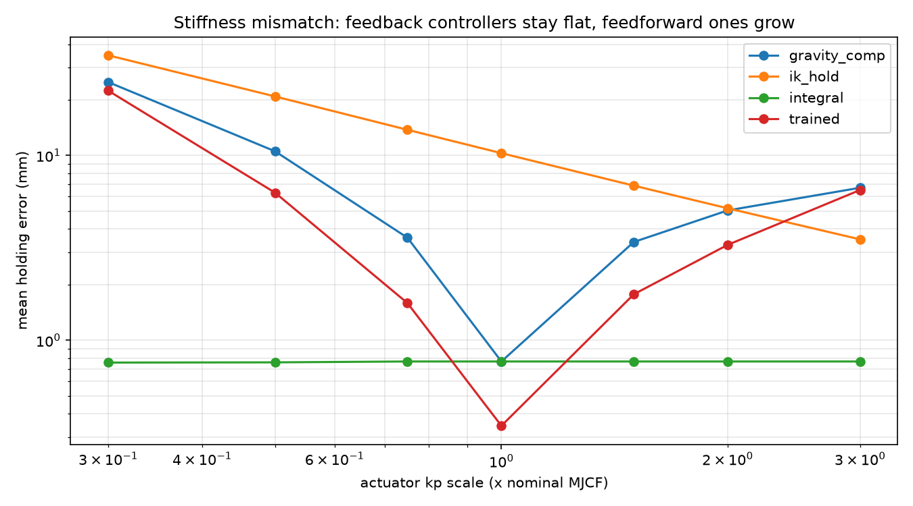
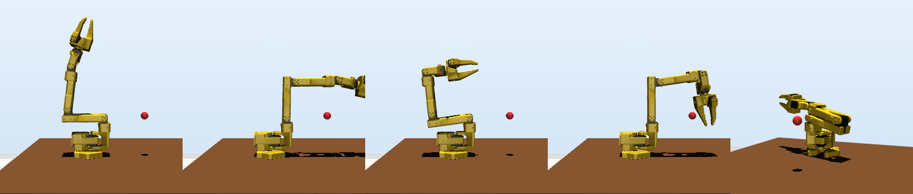
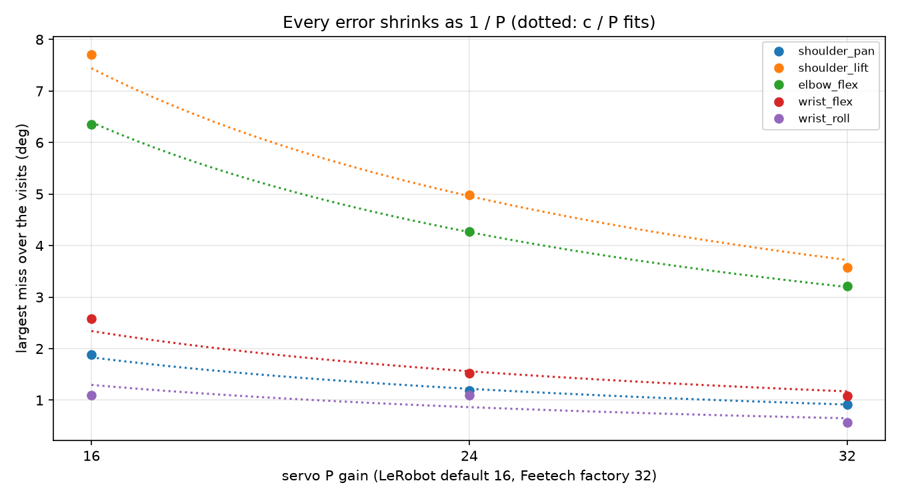
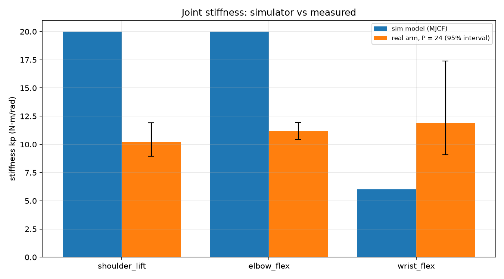
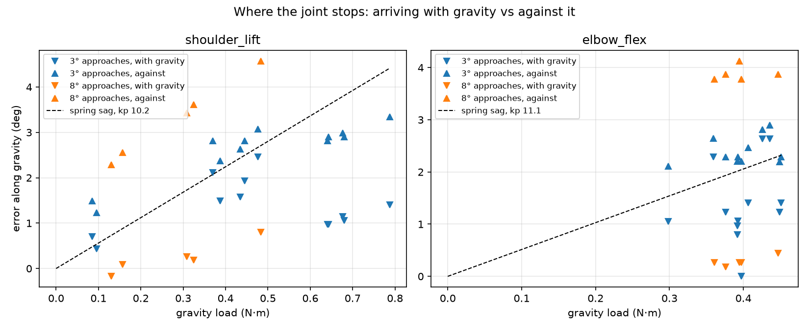
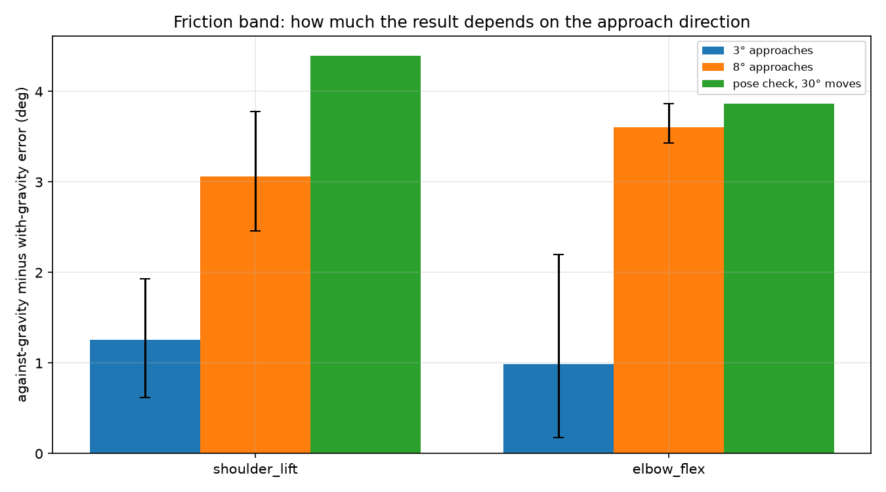

# What we learned on the first hardware day (2026-10-31)

**In one paragraph:** The real SO-101 arm is about half as stiff as the simulator thinks, and its servo friction is
about as strong as gravity. As a result, a joint that moves down with gravity lands almost exactly on its goal, but a
joint that moves up against gravity stops about 4° short. That is roughly 10–20 mm at the gripper, against a 2 mm
target. The simulator has the stiffness wrong and has no lasting friction at all. The current policy was trained on
that simulator and only works within a narrow stiffness range, so it will not transfer as is. We have now measured
everything needed to fix the simulator, and the next step is code, not more hardware.

This page summarises every experiment. Each detailed note is linked at the end, and every number points to its data.

## 1. The trained policy was already known to be fragile (sim only, before hardware)

In simulation the reach policy holds the target to 0.34 mm, but only while the joint stiffness stays between 0.75×
and 1.5× the simulator's value. Outside that window its error grows quickly (22 mm at 0.3×). A simple integral
controller stays below 1 mm everywhere. So the policy learned a fixed correction for one particular arm, not a
feedback loop.

Data: `experiments/2026-10-25_reach_robustness/`. Details: [D-08](../differences.md).

## 2. LeRobot's angles and the simulator's angles differ by up to 27°

LeRobot's zero for each joint is not the simulator's zero. We moved the arm by hand into reference poses (upper arm
straight up, forearm level, and so on) and compared. Every joint turns the same way in both, but the shoulder is off
by 27° and the elbow by 7°. Without this correction the simulator drew poses that were in the air as being inside
the table. With it, the hand-held poses all sit above the table in the simulator.

Data: `data/joint_mapping/2026-10-31_rbe501_follower/references.json`. Correction: `HardwareConfig.joint_map` in
`src/rbe_501_so101/config.py`. Details: [D-11](../differences.md).

## 3. About 5% of training targets are out of the real arm's reach

The real shoulder goes 15° further back than the model allows, but 39° less far forward. After adding a safety
margin, 4.8% of the poses used in training need a joint angle the real arm can't reach (mostly the elbow). All 10
fixed test targets are reachable.

Details: [D-02](../differences.md).

## 4. The encoders tell the truth; the misses are the servos

We sent the arm to five poses defined in the simulator (for example "upper arm vertical, forearm level") and compared
the encoder readings with what we saw. Every miss we saw by eye showed up in the encoders, with the same size and
direction. So the angle correction is right, and the encoders can be trusted to measure the servos' errors. A level
or protractor is only needed to check the angle correction itself.

Data: `data/pose_check/2026-10-31_rbe501_follower/`. Details: [pose check](2026-10-31_pose_check.md).

## 5. Raising the servo gain shrinks every error proportionally; we chose P = 24

LeRobot sets the servo's position gain P to 16, and the factory value is 32. At 16, 24 and 32, every error scaled as
1/P: double the gain and the miss halves. P = 32 made the motion jerky and the arm rang briefly at the end, so we chose
24. That cuts every error by about 35% compared with LeRobot's default. All later measurements use P = 24.

Data: `data/pose_check/2026-10-31_rbe501_follower_p{16,24,32}_*/` (each folder has `servo_settings.json` with the gain
read back from every motor). Details: [gain sweep](2026-10-31_gain_sweep.md).

## 6. The real joints are about half as stiff as the simulator assumes

From how far each joint droops under the arm's own weight, the stiffness at P = 24 is about 10–12 N·m/rad on every
joint that carries weight. That is about the same for each joint, as expected for identical servos at the same gain.
The simulator uses 20 on the shoulder and elbow (twice too stiff) and 6 on the wrist (half as stiff as real).

Data: `data/sag_check/2026-10-31_rbe501_follower_p24_192311/`; fit in `experiments/2026-10-31_sag_analysis_p24_offset8/`;
calibration file `data/calibration/actuator_calibration.json`. Details: [sag check](2026-10-31_sag_check_p24.md),
[D-01](../differences.md).

## 7. Friction is as strong as gravity, so the approach direction decides the error

Each point below is one joint at one pose. Down-triangles are arrivals moving with gravity and up-triangles are
arrivals moving against it. The dashed line is what a frictionless spring of the measured stiffness would do.

- Moving with gravity (orange down-triangles), the joint lands within 0.8° of the goal: friction cancels the sag.
- Moving against gravity (orange up-triangles), it stops 2.3–4.6° short: friction adds to the sag.
- The simulator lands on the dashed line from both sides, so it misses this effect completely.

Data: `data/sag_check/2026-10-31_rbe501_follower_p24_192311/` (8° approaches, orange) and
`data/sag_check/2026-10-31_rbe501_follower_p24_190722/` (3° approaches, blue). Details: [D-03](../differences.md).

## 8. Measuring friction needs big enough moves

The gap between the two directions (the "friction band") depends on how far the joint moves on the way in. With 3°
approaches we measured only about 1°. With 8° approaches it was 3.1–3.6°, close to the 3.9–4.4° from the pose
check's 30° moves. A 3° move is smaller than the droop plus the friction, so the joint never really comes in from the
far side. The 3° run underestimated the friction by about 3× and overestimated the stiffness, which is why the
calibration now uses the 8° run.

Bars are means over poses, and the whiskers show the smallest and largest pose. Data: the two sag-check folders
above, plus `data/pose_check/2026-10-31_rbe501_follower_p24_184714/`.

## 9. Smaller points

- **Safety:** the first sag check hit the table. Every powered tool now checks its whole path against the table
  (with a droop allowance) before torque comes on, and refuses to move otherwise. Each run also gets its own folder.
  Details: [first sag check](2026-10-31_real_sag_check.md).
- **LeRobot clips big jumps:** it never sends a goal more than 10° from where the joint is. A joint that lags behind
  a ramp therefore gets clipped, so our tools resend the final goal until it goes through unclipped.
- **Power:** the kit supplies 5 V to servos rated for 7.4 V. The arm works, but it has less torque in reserve
  than the datasheet suggests. Details: [D-09](../differences.md).

## What this means for the paper

1. **The policy won't transfer unchanged.** The real stiffness (0.5×) is outside the range where it works (0.75–1.5×).
2. **Friction is the biggest mismatch, not stiffness.** A fixed correction can't fix an error that changes with the
   direction of motion. Either the policy needs feedback-like behaviour, or the simulator must reproduce the friction.
3. **The simulator needs two changes:** the measured stiffness, and a friction model that holds the joint still
   inside a band (MuJoCo's built-in friction slowly creeps to the same spot from both sides).

## What's next (no hardware needed until after training)

1. Add a sticking-friction model to the simulator, and model LeRobot's 10° clipping and the arm's real speed.
2. Check that the calibrated simulator reproduces today's real numbers to within about 1°. Don't train until it does.
3. Configure training: only reachable targets, and stiffness and friction randomized around the measured values.
4. Run the existing controllers in the calibrated simulator to set the bar, write down the pass criteria, do a short
   smoke test, then train three seeds.

Full plan: [pre-retraining plan](2026-10-31_pre_retraining_plan.md).

## Data and notes index

| Experiment | Data | Analysis / figures | Note |
|---|---|---|---|
| Sim robustness sweep | – | `experiments/2026-10-25_reach_robustness/` | [D-08](../differences.md) |
| Joint mapping references | `data/joint_mapping/2026-10-31_rbe501_follower/` | `figures/joint_mapping_*.png` | [D-11](../differences.md) |
| First sag check (table contact) | `data/sag_check/2026-10-31_rbe501_follower/` | – | [note](2026-10-31_real_sag_check.md) |
| Pose check, P = 16 | `data/pose_check/2026-10-31_rbe501_follower/` | – | [note](2026-10-31_pose_check.md) |
| Gain sweep, P = 16 / 24 / 32 | `data/pose_check/2026-10-31_rbe501_follower_p{16_184613,24_184714,32_184813}/` | `figures/gain_sweep.png` | [note](2026-10-31_gain_sweep.md) |
| Sag check, 3° approaches | `data/sag_check/2026-10-31_rbe501_follower_p24_190722/` | `experiments/2026-10-31_sag_analysis_p24/` | [note](2026-10-31_sag_check_p24.md) |
| Sag check, 8° approaches | `data/sag_check/2026-10-31_rbe501_follower_p24_192311/` | `experiments/2026-10-31_sag_analysis_p24_offset8/`, `figures/real_sag.png` | [note](2026-10-31_sag_check_p24.md) |
| Figures on this page | all of the above | `experiments/2026-10-31_hardware_figures/` (`summary.json` has every plotted number) | – |

To regenerate the figures, use the command in the docstring of `scripts/sim2real/analyze/hardware_figures.py`.
