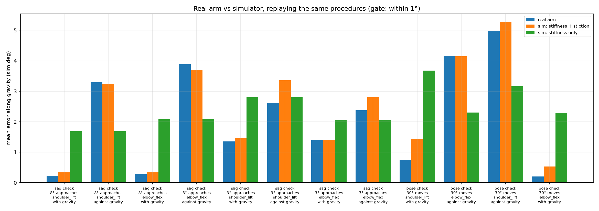

# The simulator now reproduces the real servo, and the retraining run is configured (2026-10-31)

**In one sentence:** with the measured stiffness plus a friction model on the servo goal, the simulator reproduces
every real direction-dependent error we measured to within 1°. A new preset, `residual_ik_sim2real`, trains on that
simulator, and the acceptance criteria are fixed before training. The current policy fails them (8.9 mm against a
2 mm limit), and integral control sets the bar at 0.8 mm.

This covers plan steps 8–16 of the [pre-retraining plan](2026-10-31_pre_retraining_plan.md). The measurements it
builds on are in the [hardware findings](2026-10-31_hardware_findings.md).

## 1. The servo model

The real STS3215 acts like a stiff spring toward its goal with static friction on top. A joint only moves once the
spring pulls harder than friction, so it stops one friction band short of the goal on whichever side it came from.
MuJoCo's own friction can't do this, because it slowly creeps to the same spot from both sides (D-03).

`ServoEffectsBackend` (`src/rbe_501_so101/envs/servo_effects.py`) sits between the controller and the MuJoCo actuator
and changes the goal the actuator sees:

- **Friction as hysteresis on the goal.** The goal trails the command by up to a half-band \(b\). The band widens
  with gravity load, \(b = b_0 + s\,|\tau_g|\), fitted from the 8° sag check:

  | joint | \(b_0\) | slope \(s\) |
  |---|---|---|
  | shoulder lift | 0.93° | 2.0°/N·m |
  | elbow flex | 1.80° | — |
  | wrist flex | 1.07° | — |
  | pan, roll | 0.99°, 0.86° | — |

  Pure backlash ("play") has a sharp corner: after a reversal, the goal doesn't move until the command has crossed the
  whole band. The real arm starts to slip earlier, so the model rounds that corner the way Dahl friction does. A
  transition ratio of 0 gives pure play, and 1.5 fits the data best (see section 2).
- **LeRobot's relative clip.** The goal sent to the servo stays within 10° of the measured position.
- **The real command window.** Commands are clipped to the real joint range minus the 0.15 rad margin, as on the
  real backend.

## 2. The gate: does the sim reproduce the real arm?

`scripts/sim2real/analyze/calibrated_sim_gate.py` replays three real procedures on the calibrated sim through the same
code path the arm ran: the same goals, approach offsets, raised waypoint, ramps, relative clip and encoder rounding.
The procedures are the 8° sag check, the 3° sag check, and the P = 24 pose check. For each joint and arrival
direction, the gate compares the mean error. It passes if every row is within 1°.

**Result: PASS, 12 of 12 rows, worst row 0.77°.** The sim with stiffness only (no friction model) passes 3 of 12
rows, because it lands in the middle from both sides.

| source | joint | arrival | real | sim | stiffness only |
|---|---|---|---|---|---|
| sag check, 8° | shoulder lift | with gravity | +0.23° | +0.34° | +1.69° |
| sag check, 8° | shoulder lift | against gravity | +3.29° | +3.24° | +1.69° |
| sag check, 8° | elbow | with gravity | +0.28° | +0.34° | +2.08° |
| sag check, 8° | elbow | against gravity | +3.88° | +3.70° | +2.08° |
| sag check, 3° | shoulder lift | with / against | +1.35° / +2.61° | +1.45° / +3.36° | +2.81° |
| sag check, 3° | elbow | with / against | +1.39° / +2.38° | +1.41° / +2.81° | +2.07° |
| pose check, 30° moves | shoulder lift | with / against | +0.75° / +4.98° | +1.44° / +5.27° | +3.68° / +3.16° |
| pose check, 30° moves | elbow | with / against | +0.20° / +4.17° | +0.53° / +4.15° | +2.29° / +2.30° |

With pure play (transition ratio 0), the gate passed 11 of 12 rows: the 3° shoulder row was off by 1.19°, because
pure play over-predicts the band for small reversals. Sweeping the ratio, every value from 1.5 to 3 passed, and 1.5
had the lowest mean difference (0.35°). This matters for training, because the policy's corrections near the target
are small reversals.

**Caveat:** the ratio is fitted on the same sessions the gate checks. Only the 3° session is sensitive to it; the
pose-check rows barely change with the ratio. Pan and roll stiffness are assumed (the fitted-joint mean), not
measured, because they carry no gravity load.

## 3. The training preset `residual_ik_sim2real`

This is `residual_ik` (same reward, SAC settings and observation) plus:

| setting | value | why |
|---|---|---|
| calibration | `data/calibration/actuator_calibration.json` | measured stiffness and friction band |
| stiffness randomization | 0.7–1.4× the calibration (plus damping 0.7–1.3×, payload 0–50 g) | fit uncertainty and gain drift; the old policy only worked within 0.75–1.5× of the stiffness it was trained on |
| friction band randomization | 0.5–1.5× per episode | the band varied between sessions; a sim/real mismatch here must not break the policy |
| relative clip | 10° | LeRobot's `max_relative_target` |
| targets and command limits | real joint range minus 0.15 rad | about 5% of the old targets were unreachable on the real arm (D-02) |
| command rate | 0.035 rad/step | the hardware rate, so deployment needs no slowdown (D-07) |
| residual cap | 0.2 rad (was 0.1) | sag plus the friction band at 0.7× kp and a 1.5× band reaches about 0.19 rad (11°). Under the 0.1 rad cap, even integral control saturates at 0.7× kp (1.39 mm vs 0.81 mm at 0.2 rad) |
| delay, rounding | 0–1 step per episode, encoder rounding | as in `residual_ik_calibrated` |

Deployment (`run_policy_real.py`, `robustness_sweep.py`) now caps the command step at the hardware's 0.035 rad. The
old 0.07 rad presets still run at half speed, and the new preset runs exactly as trained.

## 4. Observation audit (plan step 13)

The policy observes:

- measured joint angles and velocities;
- command minus measured angle;
- the previous action;
- the gripper position and the target offset;
- the fine target error;
- the IK joint goal.

On the real arm, velocity is the finite difference of rounded encoder readings, and the gripper position is
forward kinematics of those readings. `PerturbedBackend` already computes both the same way in sim. The "command"
is the controller's issued command in both cases, before the relative clip and before the servo's friction. The IK
goal is solved by the same solver. Nothing in the observation exists only in sim.

The one mismatch I found was the command limits: the sim used the wider model range. That is fixed (section 1). The
reward and the evaluation error use the simulator's true gripper position, and the hardware error is
encoder-based. Both are blind to the same thing: offset errors in the joint map (D-11).

## 5. Acceptance criteria, fixed before training (plan steps 14–15)

`AcceptanceConfig` (in `config.py`) and `scripts/sim2real/analyze/acceptance.py` define two kinds of condition:

- **Deployment condition:** every random draw is fixed at the measured arm, with a 1-step delay, encoder rounding,
  the relative clip and the window.
- **Stress conditions:** 0.7× kp, 1.4× kp, and a 1.5× friction band.

A retrained policy must meet all five criteria:

1. mean holding error ≤ 2 mm in the deployment condition;
2. beat IK hold by more than the spread between seeds;
3. be saturated on less than 20% of holding steps;
4. mean error ≤ 5 mm in every stress condition;
5. be no worse than integral control in any condition;
6. (added 2026-11-01, see the [retrain result](2026-11-01_retrain_sim2real_result.md)) move its command by at most 0.25° per holding step, so no dithering.

Settling time and the two-sided approach test are left to the hardware repeatability runs.

**The bar to beat** (20 episodes per condition, mean (p95) in mm, from
`experiments/2026-10-31_acceptance_reach_1m_residual_ik/`):

| condition | current policy | IK hold | gravity comp | integral |
|---|---|---|---|---|
| deployment | 8.92 (18.15), 31% saturated | 20.41 | 12.42 | **0.80** |
| kp 0.7× | 15.01 (26.72), 40% | 28.14 | 14.22 | 1.39 |
| kp 1.4× | 7.03 (14.85), 32% | 15.97 | 12.99 | 0.81 |
| friction band 1.5× | 8.37 (17.89), 31% | 23.34 | 18.34 | 0.81 |

The current policy is **rejected** on 4 of 5 criteria. Gravity compensation removes the sag but not the friction
band, so it stays at 12–18 mm. Integral control keeps integrating until the command pulls past the band, so it is
almost unaffected by friction.

Criterion 5 is strict: the retrained policy must hold below about 0.8 mm with friction on. If that proves out of
reach, the honest fallback is to report that integral control is the better hardware controller, not to relax the
criterion after the fact.

## 6. Smoke test (plan step 16)

I trained 50k steps on `residual_ik_sim2real` (seed 0, `checkpoints/smoke_residual_ik_sim2real/`):

- It took 85 s at about 600 steps/s, compared with 5,000 steps/s for the env alone (the new env is 14% slower than
  `residual_ik_calibrated`, which is negligible next to the SAC updates).
- The episode reward rose from −1,870 to −1,300.
- The run config saved and reloaded with the new fields.
- The 50k-step checkpoint already beats IK hold: 10.8 mm against 20.4 mm in the deployment condition, saturated on
  18% of holding steps (`experiments/2026-10-31_acceptance_smoke_50k/`). No crashes or NaNs.

The full run (3 seeds × 1M steps, as for `reach_1m_residual_ik`) should take about 28 minutes per seed on this
machine.

## Data

- Gate: `experiments/2026-10-31_calibrated_sim_gate/` (README, `gate.png`, `report.json`).
- Acceptance and baselines: `experiments/2026-10-31_acceptance_reach_1m_residual_ik/` and
  `experiments/2026-10-31_acceptance_smoke_50k/`.
- Real sessions replayed:
  - `data/sag_check/2026-10-31_rbe501_follower_p24_192311` (8°);
  - `data/sag_check/2026-10-31_rbe501_follower_p24_190722` (3°);
  - `data/pose_check/2026-10-31_rbe501_follower_p24_184714`.
- Calibration: `data/calibration/actuator_calibration.json`.
