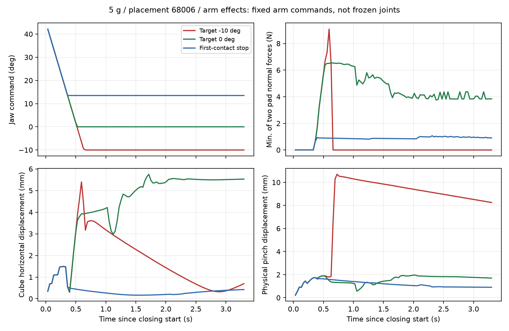

# Closing endpoint and retention — 2026-11-26

**A useful simulation fix is now validated:** keep the Cartesian acquisition,
but command the moving jaw to **0 degrees instead of -10 degrees**. In the
original 200-step task it lifts **160/160 fresh cases** across both dynamics modes
and repairs **24/24 known regression cases**, with no observed table/approach
contacts and no >1 mm pre-close cube movement.

This is a controller setpoint change, **not** a gain, joint-limit, collision,
model or trained-policy change. It remains opt-in so the old baseline is preserved.
No RL training occurred. Results apply to the current simulated 25 mm cube and
gripper model, not a calibrated hardware jaw-angle/force prescription.

Table-contact counts refer to robot/table contact, not the cube resting on the table.

## 1. Isolate closing before lift

Use the frozen table-checked Cartesian approach. Intercept the first authorized
closing action before it executes; flush two zero-arm-command periods to drain
the pending arm command. Then hold all five integrated arm commands fixed while
testing the jaw. Do not freeze joint positions: physical arm deflection remains.

Every profile receives 100 closing periods (3.3 s). If the final five periods
retain both pad contacts, recompute the lift target from the settled cube and
allow 100 lift periods, using the existing arm rate and permanent contact-loss
abort. A closing failure is counted as failure without attempting lift. Diagnostic
maximum horizon is 400 steps, **not the original 200-step task**; these results
alone cannot establish end-to-end improvement.

Five profiles, with all physical parameters fixed:

| Profile | Endpoint | Max increment per period | Contact stop |
|---|---:|---:|---|
| Original endpoint | -10 deg | 0.05 rad | None |
| Zero endpoint | 0 deg | 0.05 rad | None |
| Slower original endpoint | -10 deg | 0.025 rad | None |
| First-contact latch | Initial -10 deg | 0.05 rad | First two-pad contact |
| Three-contact latch | Initial -10 deg | 0.05 rad | Three consecutive two-pad contacts |

The latch holds the current **commanded** angle after its contact condition;
it is not force control. It uses privileged simulated contacts and is not a
hardware implementation. The selected fixed 0-degree endpoint does not require
that new contact-based jaw-stop rule; the existing lift contact guard still applies.

SHA256 comparison verifies identical prepared qpos, qvel and controller commands
for paired profiles. Recorded arm-command drift during closing is zero. Physical
pinch drift is measured separately, so contact-induced joint deflection is visible.
Forces, cube rotation/translation and jaw angle are recorded, not inferred from
final success alone.

## 2. Diagnosis and profile selection

Known seeds 68006/69005/75003, four masses, both dynamics modes: 24 episodes per
profile. Tuning seeds 76000–76002: another 24 per profile. All acquisition states
are paired. Freeze the profile before independent validation on 77000–77019.

| Profile | Known lifts /24 | Tuning lifts /24 |
|---|---:|---:|
| Original endpoint -10 deg | 20 | 22 |
| Endpoint 0 deg | **24** | **24** |
| Slower -10 deg | 20 | 23 |
| First-contact latch | 9 | 20 |
| Three-contact latch | 20 | 23 |

The known 5 g / seed 68006 / arm-effects case is revealing:

| Closing observation | -10 deg | 0 deg | First-contact latch |
|---|---:|---:|---:|
| Peak fixed-pad normal force | 9.08 N | 6.55 N | 1.12 N |
| Peak moving-pad normal force | 15.88 N | 6.95 N | 1.07 N |
| Max physical pinch drift | 10.70 mm | 1.97 mm | 1.75 mm |
| Max cube rotation change | 25.21 deg | 41.44 deg | 6.71 deg |
| Retains and lifts | No | Yes | Yes in this case |

Arm commands are fixed in all three columns. The -10-degree target continues
squeezing after contact, produces larger force/arm-deflection transients, and
loses stable grasp **before lift**. Slower -10-degree closing also fails this
case. The model supports excessive endpoint demand as a major mechanism; this
does not prove the physical robot has the same force response.

The zero endpoint is not superior on every motion metric: the cube rotates more
in this particular diagnostic while seating, despite retaining successfully.
Final cube orientation is not an optimization objective in the current task.
First-contact stopping is gentler in this example, but it fails other cases,
especially stiffness-only tests: bilateral contact alone does not guarantee a
load-bearing grasp. Do not promote the contact latch from a single good replay.



This plot is a known diagnostic case, not an independent statistical sample.
Raw force/rotation histories and a figure regeneration script are preserved.

## 3. Independent isolated-closing validation

Profile selected: **position_zero**, fixed endpoint 0 deg, original 0.05 rad rate.
Frozen criterion: >=95% final success at every mass/mode, known cases retained and
lifted, zero table contacts and warnings. Independent seeds 77000–77019:

| Dynamics | -10-degree profile | 0-degree profile |
|---|---:|---:|
| Stiffness only | 80/80 | 80/80 |
| Arm effects | 74/80 | **80/80** |

All six -10-degree failures under arm effects fail stable closing before lift
(five at 5 g, one at 20 g). All selected-profile cases complete closing and early
lift. No observed robot/table contacts during measured closing/lift stages and
no warning episodes. All 560 diagnostic cases complete preparation; the protocol verifies matched initial
states across profiles; it does not discard preparation failures from denominators.

Total isolated-closing experiment: **560 episodes** (240 known/tuning + 320
validation), with identical stage budgets. Do not compare these longer episodes
directly to the preceding 200-step results.

## 4. Original-horizon end-to-end validation

Apply the selected fixed endpoint to the existing Cartesian sequence. Both the
controller and guard receive the new closing setpoint, including sampled closure
geometry checks. Keep the original **200 steps / 6.6 s** and the existing 25-step
minimum closing dwell. No extra diagnostic waiting time is carried over.

Changing `GripperConfig.close_deg` in this opt-in builder changes the commanded
endpoint; it does **not** change compiled joint limits or geometry. Regression
tests verify exact equality of actuator gains/bias/force and control ranges,
joint ranges, body mass/inertia/gravcomp, friction, contact parameters and collision
masks between the old/new endpoints. The physical model is unchanged.

Freeze this validation protocol before fresh seeds **78000–78019**. Four masses,
both dynamics modes, three controllers; additionally rerun the 24 known cases per
controller. Total **552** original-horizon episodes.

| Controller | Known cases /24 | Fresh stiffness /80 | Fresh arm effects /80 |
|---|---:|---:|---:|
| Legacy scripted baseline | 21 | 80 | 80 |
| Cartesian acquisition, -10 deg | 21 | 80 | 76 |
| Cartesian acquisition, **0 deg** | **24** | **80** | **80** |

Full acquisition/retention gate for the selected candidate passes: every mass/mode
20/20 fresh lifts, all known regressions repaired, no observed table/initial
approach contacts, no warnings and no >1 mm pre-close XY movement. In the arm-effect
batch, legacy has approach contact in 8/80 and >1 mm pre-close motion in 31/80;
both Cartesian controllers have zero such episodes. Selected maximum pre-close
movement is 0.218 mm. The old Cartesian endpoint has four fresh 5 g failures.

The selected candidate matches legacy lift count on this fresh batch and improves
its acquisition behavior and known regressions. It improves lift retention over
the previous Cartesian prototype. Twenty fresh placement seeds are reused across
masses and modes; these are not 160 independent random placements. Zero observed
failures in this finite simulation sample is not guaranteed population reliability
or physical validation.

## Validation and preserved baseline

**408 tests passed, one optional LeRobot test skipped.** Initial closing tests
failed before implementation; tests cover rate limits, contact-latch semantics,
normalized action bounds, fixed arm commands and unchanged compiled physics.

Physics-step audit: two endpoints, 5/20 g, arm effects, seeds 68006/75003/78000:
12 episodes / **79,200 physics steps**, zero table-contact substeps. All six selected
candidate cases lift successfully; its audited pre-close movement is <=0.140 mm.
The subset audit is not a continuous-safety guarantee for every tested episode.

Saved replays show the previously failed 5 g cases 68006 and 75003 now lifting
within the original horizon. All source model/calibration/old-policy hashes match;
v2 companions also match their preceding frozen manifest. No trained neural
policy was used, updated or joined with reaching. The existing scripts/defaults,
source MJCF and original checkpoints remain intact.

New files: `control/gripper_closing.py` (small profile/latch helpers), a headless
diagnostic/end-to-end/replay runner, regression tests, and recorded findings/data.
The new builder exposes a clean, opt-in endpoint change; it does not silently
modify `GripperConfig`'s global default.

## Reproduce and watch

Evidence: `experiments/2026-11-26_gripper_closing/` contains diagnostic protocol,
profiles, paired states, force traces, plot, selection and held-out results.
`end_to_end/` contains the original-horizon protocol, resolved setup, all three
comparisons, passed assessment and substep audit. All output directories must be new.

```powershell
# Full isolated closing comparison
uv run --locked python -m scripts.sim2real.analyze.gripper_closing_check --out experiments/closing_repeat

# Independent 200-step validation of the frozen endpoint
uv run --locked python -m scripts.sim2real.analyze.gripper_closing_check --end-to-end experiments/2026-11-26_gripper_closing/frozen_selection.json --out experiments/closing_e2e_repeat

# Watch the repaired 5 g case; headless without --viewer, always saves phase PNGs
uv run --locked python -m scripts.sim2real.analyze.gripper_closing_check --replay experiments/2026-11-26_gripper_closing/frozen_selection.json --mass-kg 0.005 --placement-seed 68006 --viewer --out experiments/closing_zero_viewer
```

Replay needs the model/assets/calibration and frozen endpoint, not a trained policy.
Full comparison commands additionally fingerprint the locally retained older
checkpoint companions; they are not uploaded with this report.

Next freeze this complete setup as an explicit calibrated scripted reference and
review it with the teammate who has the robot. Before another RL pilot, serialize
the exact acquisition and 0-degree closing setup into its training preset. Do not
reuse old policy results as though they were trained with this controller. Hardware
jaw-angle mapping/contact force and the uncalibrated gripper model still need
physical validation; 0 degrees here denotes the model joint coordinate.
