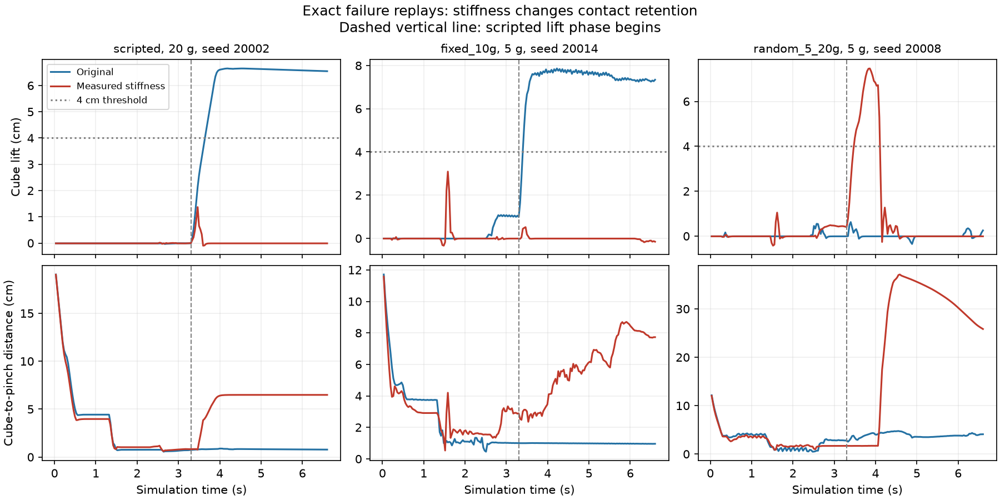

# Exact pick-and-lift failure replays (2026-11-26)

## What was tested

Starting from integration commit `96061bd`, replay every failed condition from
the 480-episode stiffness sweep and its matched condition under the other
dynamics setting. This produces 32 unique episodes: all 18 failures and 14
matched successful controls. Every final success flag and final lift matches
the sweep (lift tolerance 1 micrometer). All replay observations/rewards are
finite; no MuJoCo warnings were recorded. No training or policy/physics tuning
was performed.

Each 200-step trace records world cube/pinch positions, measured/commanded
joint angles, policy actions, contact geoms/gaps/normal forces, phase labels,
and grasp/success/table-contact events at control boundaries. These are not
physics-substep traces, and contact force is a solver output, not hardware data.
Fifteen offscreen close-ups were saved for three representative failures;
representative rendered frames were visually inspected.

## Observed failure signatures

| Dynamics | Never observed two-pad grasp | Grasp observed, never success | Success observed, lost by end |
|---|---|---|---|
| Original | 2 | 4 | 0 |
| Measured stiffness only | 1 | 10 | 1 |

These categories describe evidence, not a proven causal diagnosis. A one-step
two-pad contact does not establish a stable grasp.

### Fixed-10-g policy, 5 g cube, placement 20014

- Original dynamics: successful final lift of 7.34 cm.
- Measured stiffness: two-pad contact occurs only at step 86 and is gone at 87;
  the final lift fails. The 3.09 cm peak at step 48 occurs without two-pad
  contact and therefore is not a successful grasp/lift.
- The close-phase rendered image shows the cube outside the closed jaws. The
  trace records moving-pad-only contact at step 85 and no cube/finger contact
  at step 100. This is a grasp acquisition/alignment failure, not simply a
  controller that fails to lift high enough.

### Scripted controller, 20 g cube, placement 20002

- Original dynamics: two-pad grasp at step 81; success at 111; final lift 6.55 cm.
- Measured stiffness: fixed finger touches the table from step 46 during
  descent, two-pad grasp at step 82, peak lift 1.37 cm at 105, grasp lost at 106.
- At the end of descent, cube-minus-pinch vertical error is about 6.9 mm with
  measured stiffness versus 4.8 mm originally. Shoulder/elbow tracking errors
  also differ. These observations are consistent with changed sag affecting
  clearance/contact placement; they do not isolate sag as the only cause.
- The cube is initially grasped but contact is not retained through early lift.

### Random-mass policy, 5 g cube, placement 20008

- Measured stiffness: grasp at step 79; success at 106 (3.498 s); peak lift
  7.47 cm at 117; both-pad contact and success lost at 124 (4.092 s).
- The gripper command remains near closed around separation: -10 degrees at
  step 122, -9.57 at 123, and -10 at 124. The measured jaw angle jumps from
  about 0.29 to -9.99 degrees as the object ceases to obstruct closure.
- Cube-to-pinch separation grows sharply; the post-loss rendered frame shows
  the cube separated from the gripper near the table. This supports contact
  retention loss rather than a deliberate open-gripper command as the immediate
  event. Substep forces and motion would be needed to distinguish slip,
  geometric ejection, and other mechanisms conclusively.
- The original policy also fails this placement, but never reaches the success
  threshold. Changed stiffness changes the failure path, not just the outcome.

## Implications before changing controllers

1. Do not treat peak height or brief contact as success; retain the final-state
   gate and explicitly track losses.
2. Diagnose descent clearance/grasp alignment separately from lift retention.
   Raising a waypoint might help table contact but could also prevent grasping.
3. Avoid increasing friction or gripper force to hide these failures. The jaw
   dynamics and pad friction are not hardware calibrated.
4. The phase sequence is time scheduled: lift starts at step 101 regardless of
   whether a secure grasp was acquired. A grasp-gated lift is a candidate
   controlled experiment, not a change made by this investigation.
5. These remain measured-stiffness-only tests. Full reaching servo/friction and
   sensing effects have not been made manipulation compatible or validated.

## Replay and evidence

Live viewer for the drop case (new output directory required):

```powershell
uv run --locked python -m scripts.sim2real.analyze.replay_pick_lift --controller random_5_20g --mass-kg 0.005 --placement-seed 20008 --calibrated --viewer --out experiments/drop_viewer_replay
```

Omit `--viewer` for headless tracing; add `--frames` for phase-end PNGs. The
interactive viewer path is provided; the investigation used offscreen rendering.

- Raw traces, events, and snapshots: `experiments/2026-11-26_pick_lift_failure_replays/`.
- Index of all replay outcomes: that directory's `summary.json`.
- Comparison plot: `reports/figures/pick_lift_failure_replays_2026-11-26.png`.
- New replay helpers have timing/event regression tests; existing sweep tests
  remain unchanged. Combined suite: **361 passed, 1 skipped** (optional LeRobot
  configuration check).


